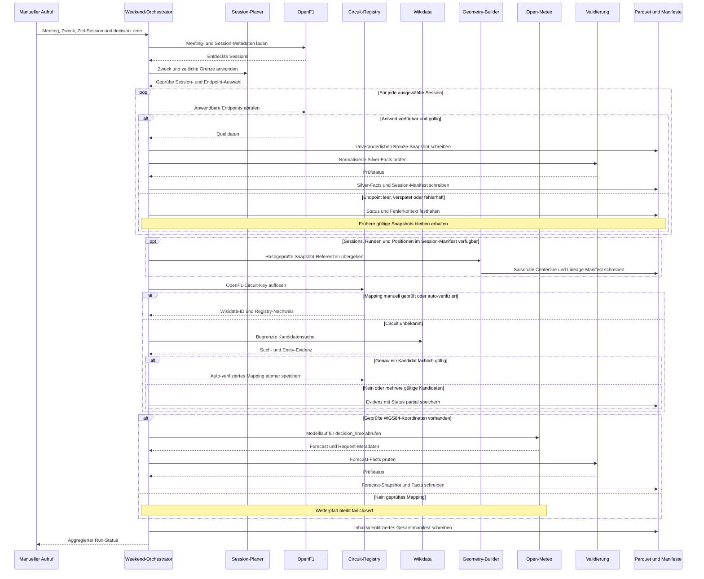
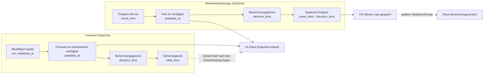
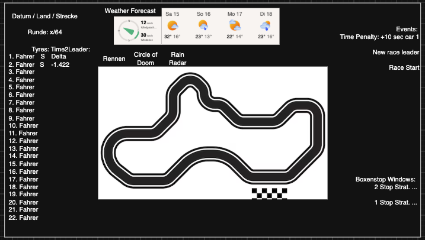
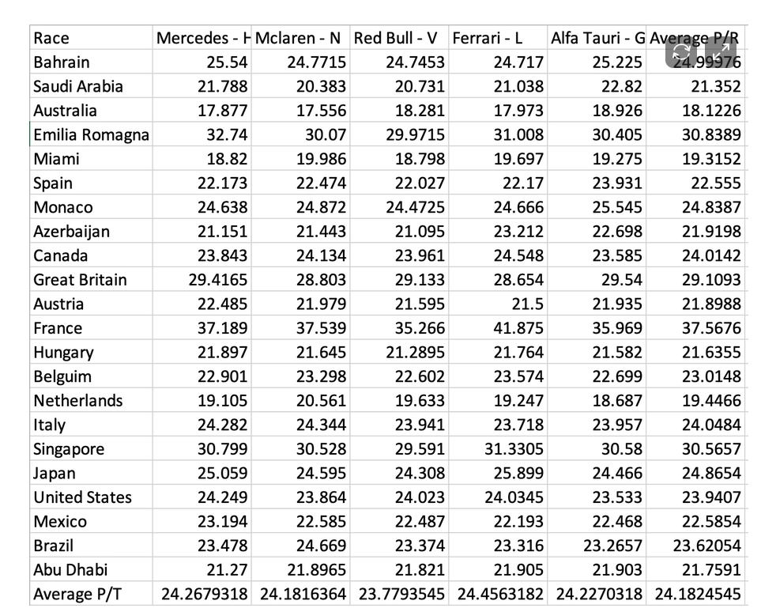
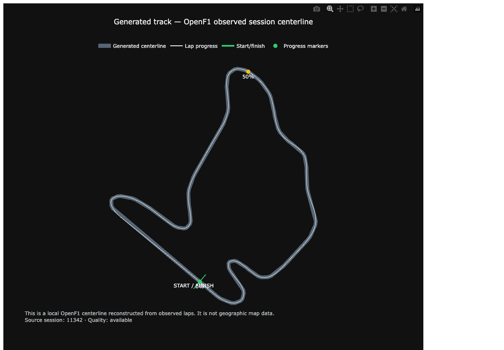
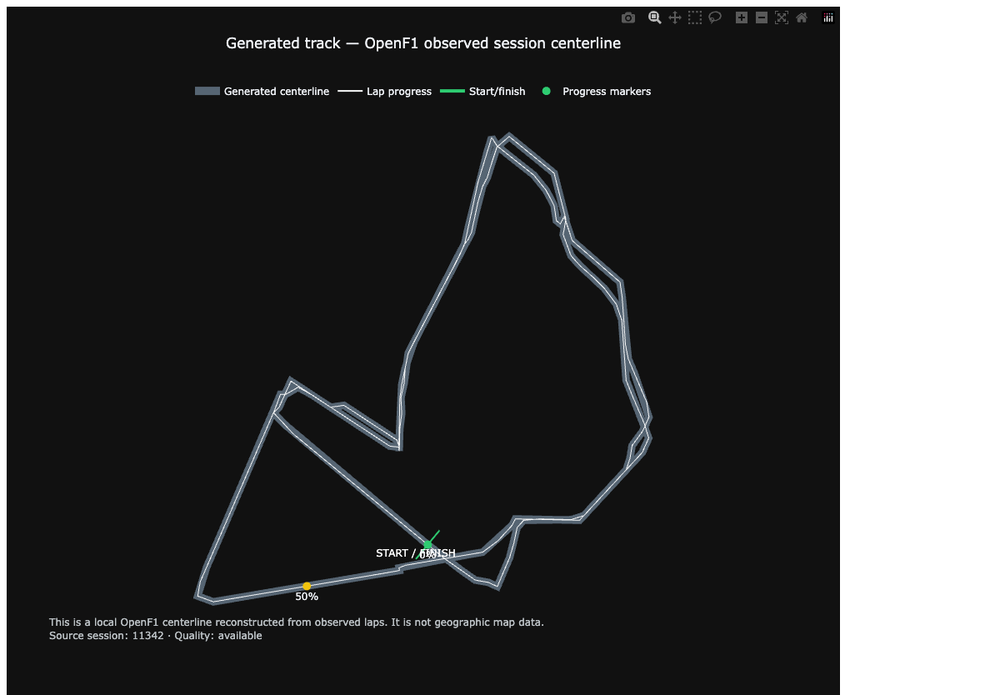
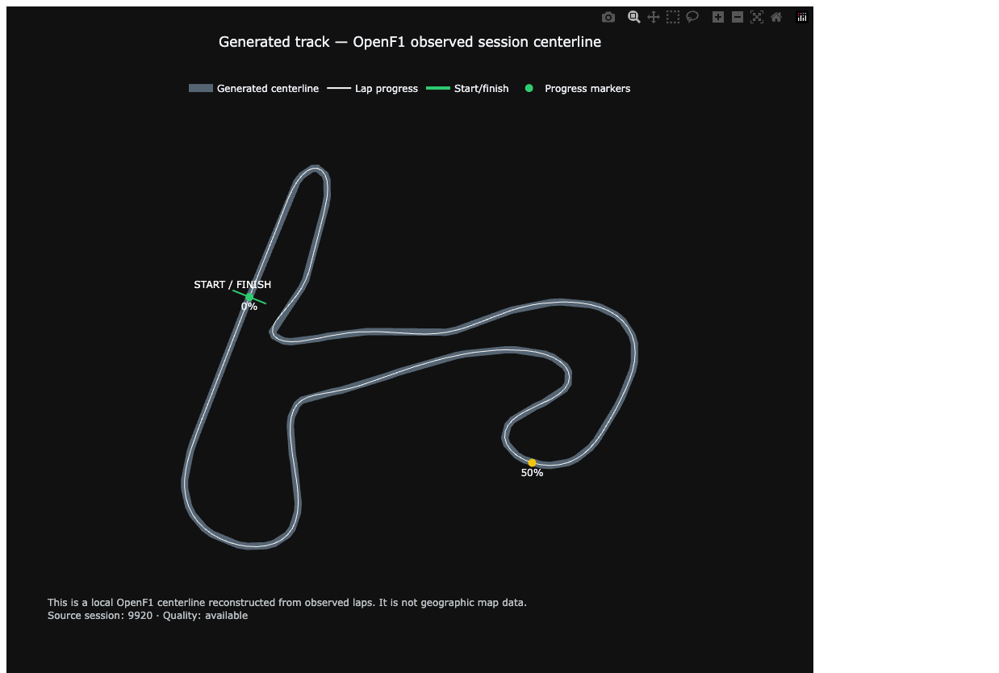

# Projektdokumentation

Diese Datei ist die Grundlage für die spätere schriftliche Abgabe und beschreibt die zentralen Daten-, Speicher- und Zeitkonventionen eigenständig. Der jeweils verbindliche Detailstatus, das MVP-Ziel und alle Ausführungsbefehle werden weiterhin ausschließlich in der [`README.md`](../README.md) gepflegt.

## 1. Ausgangslage und Ziel

Öffentliche Formel-1-Daten sind über mehrere inoffizielle Quellen verteilt und unterscheiden sich in Struktur, Aktualität und Bedeutung. Das Hauptprodukt ist deshalb eine automatisierte Datenpipeline für ein ausgewähltes Rennwochenende. Sie entdeckt die vorhandenen Sessions, führt begrenzte Lade- und Wiederholungsjobs aus, validiert die Antworten und hält Herkunft sowie Qualität jedes Snapshots fest.

Ein historischer Replay ist ein nachgelagerter Ausführungsmodus dieser Pipeline. Obwohl alle Renndaten bereits lokal vorliegen können, gibt er sie nur bis zu einem simulierten Zeitpunkt frei. Qualifying- und Strategieberechnungen arbeiten dadurch so, als würden die Daten gerade eintreffen. Der erste MVP umfasst Pipeline und Dashboard V1; die inzwischen ergänzten transparenten Qualifying- und Rennstrategie-Baselines sind nachgelagerte Verbraucher. Komplexe Optimierung, Race-Prediction und bezahlte Live-Ingestion bleiben ausgeschlossen.

### 1.1 Einordnung in die Vorlesung

Die vier Vorlesungsunterlagen verstehen Data Science Programming nicht primär als einmaliges Modelltraining, sondern als Verbindung von Programmierung, Datenmanagement, Auswertung und einem realen Entscheidungsprozess. Das Projekt folgt diesem Verständnis: Kernprodukt ist der wiederholbar ausführbare Weg von externen F1- und Wetterdaten zu validierten, versionierten und auswertbaren Datenbeständen. Replay, Dashboard und spätere Berechnungen sind nachgelagerte Verbraucher und nicht Eigentümer der Datenerfassung.

| Kompetenz- oder Bewertungsschwerpunkt | Umsetzung im Projekt | Nachweis |
|---|---|---|
| Programmiergrundlagen praktisch einsetzen | Python-Module, Klassen, Funktionen, Bedingungen, Iteration, Datei-I/O, HTTP-Clients und DataFrames bilden eine ausführbare Anwendung statt eines einmaligen Notebooks. | Quellcode unter `src/f1_pipeline/` und reproduzierbare Befehle in der `README.md` |
| Automatisierungspotenzial erkennen und Arbeitsschritte bewerten | Meeting-Auswahl, Session-Discovery, zweckabhängige Endpoint-Planung, Ingestion, Validierung, Transformation und Manifestbildung laufen als zusammenhängender Job. Seltene fachliche Freigaben, etwa ein mehrdeutiges Circuit-Mapping, bleiben bewusst manuell. | Weekend-Orchestrator, Job-Service und Pipeline-Manifeste |
| Datenmanagement mit Analyse und Entscheidung verbinden | Bronze-Snapshots und Silver-Facts versorgen Saisonübersicht, Replay, Pace-Auswertung und spätere Calculation Snapshots über dieselben geprüften Eingänge. | manifestgebundene Read Models und Input-Hashes |
| Verständlichkeit und strukturierte Datenflüsse | Zuständigkeiten von Quellen, Pipeline, Race State, Berechnung und Darstellung sind getrennt; Datenfluss und zeitliche Freigabe werden grafisch dokumentiert. | Sequenzdiagramm in Abschnitt 2.4 und Zeitachsen in Abschnitt 4 |
| Reproduzierbarkeit und Korrektheit | Unveränderliche Snapshots, SHA-256-Hashes, Schema- und Schlüsselprüfungen, versionierte Manifeste sowie deterministische Berechnungs-IDs identifizieren die Eingaben eines Ergebnisses. | Manifeste unter `data/curated/manifests/` und Verifikationsartefakte |
| Robustheit und Fehlertoleranz | Quellenfehler bleiben isoliert, Abrufe besitzen Timeouts und begrenzte Retries, Schreibvorgänge sind atomar, und fehlende Werte werden nicht erfunden. | Status `available`, `partial`, `stale` und `unavailable` sowie dokumentierter Fehlerkontext |
| Erweiterbarkeit | Quellenadapter, kanonische Facts, Replay, Analysen und Dashboard sind getrennte Schichten. Neue Berechnungen verwenden den bestehenden temporalen und manifestgebundenen Vertrag. | Paketstruktur und gemeinsamer Fact-Cut |
| Wissenschaftlich sauberes Vorgehen | Annahmen und Heuristiken werden gekennzeichnet, Quellen getrennt verglichen und komplexere Modelle erst nach einem zeitlich korrekten Baseline-Vergleich erwogen. | Pace-Cross-Check, Walk-forward-Auswertung und Abschnitt 6 |
| Quellen und Lizenzen | Für jede externe Quelle existiert eine Quellenkarte; fremder Code wird nur bei geklärter Lizenz übernommen. | `docs/sources/` und Abschnitt 9 |

Für die Abgabe bedeutet dies: Code, Dokumentation, Präsentation und Funktionsnachweis müssen gemeinsam ein nachvollziehbares System zeigen; eine Klausur ist nicht vorgesehen. Der schriftliche Zielumfang beträgt 12 bis 24 Seiten mit hoher Informationsdichte. Die Abschlusspräsentation ist auf 20 Minuten Darstellung und 10 Minuten Diskussion ausgelegt und soll Vorgehen und Ergebnisse in den Mittelpunkt stellen. Neben 36 Kontaktstunden sieht das Modul 89 Stunden Selbststudium vor, weshalb eigenständige Implementierung und Überprüfung ein wesentlicher Teil der Projektleistung sind. Diese Dokumentation konzentriert sich daher auf Implementierung, Datenfluss, Entscheidungen, Fehlerfälle und überprüfbare Ergebnisse. Eine ungefähre Priorisierung von 45 % Pipeline, 20 % Datenqualität und Robustheit, 20 % Architektur und Automatisierung sowie 15 % Analysen und Visualisierung ist eine Interpretation der mehrfach betonten Vorlesungsziele, keine offizielle Bewertungsgewichtung.

## 2. Vorgehen

### 2.1 Konzept und Automatisierungspotenzial

Vor der Implementierung wurden die Leitfragen aus der Vorlesung auf den F1-Anwendungsfall übertragen:

| Leitfrage | Festlegung für das Projekt |
|---|---|
| Welche Informationen werden benötigt? | Meeting- und Sessionidentität, Fahrer und Teams, Runden, Positionen, Abstände, Reifenstints, Boxenstopps, Race Control, Ergebnisse, Meisterschaftsstände, Streckenbezug sowie Wetter-Forecasts und -Beobachtungen. |
| In welcher Form liegen sie vor? | OpenF1, Wikidata und Open-Meteo liefern JSON über HTTP; FastF1 liefert Python-Objekte beziehungsweise DataFrames. Kuratierte Tabellen werden als Parquet und Metadaten als JSON gespeichert. |
| Wie sieht das Datenmodell aus? | Saisonbezogene Dimensionen beschreiben Meeting, Circuit, Session, Fahrer und Team. Kanonische Facts referenzieren diese Identitäten und tragen Ereignis-, Verfügbarkeits- und Ingestionszeit sowie Quellen- und Hashnachweis. |
| Gibt es einen zeitlichen Verlauf? | Sessions und Rennereignisse bilden Ereignisfolgen; Wetter-Forecasts besitzen zusätzlich Modelllauf, Veröffentlichungszeit und Vorhersageziel. Der Wissensstand verändert sich mit jeder Verfügbarkeit. |
| Wie werden Daten abgerufen? | Ausschließlich über gekapselte Quellenadapter und zweckabhängige Jobprofile. Das Dashboard liest lokal und übermittelt nur Ladeabsichten an den getrennten Job-Service. |
| Wie wird der Dienst geschont? | Feste Timeouts, begrenzte Retries mit Backoff, `Retry-After`, ein Mindestabstand für OpenF1-Aufrufe, lokale Cache-Wiederverwendung und bedarfsorientierte Endpoint-Auswahl begrenzen Last und Laufzeit. |
| Welche Risiken bestehen? | Ausfälle, leere oder verspätete Antworten, Schemaänderungen, Duplikate, fehlende Runden, uneindeutige Identitäten, unterschiedliche Quellsemantik, Rate Limits und Zukunftswissen im Replay. |
| Wie werden fehlerhafte oder fehlende Daten behandelt? | Pflichtfelder, Datentypen, Schlüssel, Wertebereiche und UTC-Zeiten werden geprüft. Fehlendes bleibt fehlend; unsichere Teilergebnisse erhalten einen expliziten Status und ersetzen keinen letzten gültigen Snapshot. |
| Wie sieht die automatisierbare Lösung aus? | Auswahl → Discovery → Abruf → Bronze-Snapshot → Validierung → Silver-Transformation → Manifest → Read Model beziehungsweise Analyse. Jeder Schritt besitzt eine begrenzte Verantwortung. |
| Wie werden Daten aktualisiert? | Wiederholte idempotente Jobs erzeugen neue unveränderliche Snapshots oder verwenden geprüfte vorhandene Daten. Manuelle Dashboard-Intents sind umgesetzt; persistierte zeitversetzte Retries und automatische Finalisierung bleiben geplant. |

Die bewusst einfachen Machbarkeitsnachweise sind erstens Session- und Endpoint-Abdeckung samt Qualitätsstatus, zweitens Kalender, Ergebnisse, Siege, Podien und Meisterschaftsstände, drittens Pace nach Fahrer und Reifenstint mit getrenntem OpenF1-/FastF1-Vergleich, viertens der zeitlich begrenzte Renn-Replay mit Race Control und Wetter sowie fünftens der Vergleich eines damals verfügbaren Forecasts mit späteren Beobachtungen. Diese Auswertungen prüfen Datensammlung und Automatisierung; sie setzen kein komplexes ML-Modell voraus.

### 2.2 Quellen erkunden

Zu Beginn wurden FastF1 und OpenF1 anhand historischer Sessions praktisch geprüft. Dabei wurde der technische Weg von API beziehungsweise Python-Bibliothek über Pandas bis zu Parquet nachgewiesen. Anschließend wurden Verantwortung und Überschneidungen der Quellen getrennt festgelegt.

### 2.3 Referenzfall festlegen

Als reproduzierbarer Akzeptanzfall wurde das vollständige Wochenende des Hungarian Grand Prix 2026 gewählt:

- OpenF1 `session_key=11342`
- OpenF1 Practice `11335`, `11336`, `11337` und Qualifying `11338`
- OpenF1 `meeting_key=1291` und `circuit_key=4`
- Hungaroring, 26. Juli 2026
- OpenF1 als primäre Replay- und Race-Control-Quelle
- FastF1 als unabhängiger Abgleich für Runden und beobachtetes Wetter

Belgien 2026 (`session_key=11334`) bleibt ein Regressionstest für den Circle-of-Doom-Replay. Zandvoort 2025 (`session_key=9920`) dient als zweiter Geometriefall.

Das Ziel ist nicht auf ein festes Rennformat beschränkt. Nach Auswahl eines Meetings werden alle gemeldeten Sessions entdeckt. Die Pipeline kann anschließend alle Sessions oder eine geprüfte Teilmenge nach OpenF1-Key, kanonischem Sessiontyp oder der Schnittmenge beider Filter laden. Ein Replay lädt nur das Rennen. Eine spätere Qualifying-Berechnung lädt die davor abgeschlossenen Trainingssessions; eine Rennberechnung kann zusätzlich Qualifying und Sprint verwenden. Trainingsdaten werden daher zweckgebunden automatisch geladen, aber nicht für jede einfache Kalenderabfrage.

### 2.4 Daten absichern

Die Pipeline speichert quellnahe Daten als Parquet, validiert Pflichtfelder, Schlüssel und UTC-Zeitstempel und liest geschriebene Dateien zur Kontrolle erneut ein. Erfolgreiche Snapshots bleiben erhalten, wenn ein späterer Abruf fehlschlägt. Fehler werden je Quelle und Endpoint isoliert dokumentiert.

Die aktuelle Implementierung besitzt einen idempotenten, saisonparametrierten Weekend-Orchestrator für Eventauswahl, Session-Discovery, Session-Ingestion, Silver-Transformation, Wikidata, lokale Streckengeometrie und Open-Meteo. Persistierte zeitversetzte Wiederholungen und automatische Finalisierung bleiben geplant. Automatisiert bedeutet dabei nicht live: OpenF1 wird nach Ende einer Session historisch abgefragt, solange kein kostenpflichtiger Live-Zugang verwendet wird.



### 2.5 Datenverarbeitung nach dem EVA-Prinzip

Das Vorlesungsprinzip Input → Processing → Output wird als mehrstufige Pipeline konkretisiert. Input sind unvertrauenswürdige externe JSON-Antworten, FastF1-Objekte und geprüfte Konfigurationen. Processing umfasst Datensichtung, Schema- und Inhaltsvalidierung, Normalisierung, Kombination und zeitliche Freigabe. Output sind unveränderliche Bronze-Snapshots, kanonische Silver-Facts, Manifeste, Read Models, Analysen und die read-only Darstellung.

| Pipelinephase | Technische Umsetzung |
|---|---|
| Import | Gekapselte API-Clients prüfen HTTP-Status und JSON-Grundstruktur; FastF1 wird sessionzentriert mit lokalem Cache verwendet. |
| Sichtung und Validierung | Pflichtspalten, Nicht-Null-Felder, numerische Werte, Session-Schlüssel, Geschäftsschlüssel, Duplikate und parsebare Zeitstempel werden kontrolliert. |
| Bereinigung | Typen und Einheiten werden explizit normalisiert. Unbekannte Werte bleiben leer; es gibt keine pauschale Ersatzwertbildung und insbesondere keine Ersetzung durch `0`. |
| Transformation und Kombination | Quellfelder werden auf kanonische Dimensionen und Facts abgebildet. Quellen werden über geprüfte Identitäten und zeitlich rückwärts gerichtete As-of-Zuordnungen verbunden, nicht blind zusammengefügt. |
| Datenhaltung | Parquet speichert tabellarische Daten kompakt und typisiert; UTF-8-JSON hält Manifeste, Konfiguration und Rohbelege. Temporäre Parquet-Dateien werden vor dem atomaren Ersetzen erneut gelesen. |
| Auswertung | Status- und Abdeckungsanalysen, Saisonübersicht, Pace-Vergleich, Replay und transparente statistische Baselines verwenden ausschließlich manifestgebundene Eingaben. |
| Reporting | Dashboard und reproduzierbare Artefakte zeigen Ergebnisse und klar bezeichnete Leer-, Teil- oder Fehlerzustände. |

#### Eingangsformen

Die Pipeline arbeitet mit endlichen Snapshot-Antworten und nicht mit einer dauerhaft offenen Streaming-Verbindung. Zeitaufgelöste OpenF1-Daten werden endpointweise als vollständiger Block abgerufen und anschließend gespeichert. Der historische Replay liest diese Blöcke und gibt ihre Zeilen chronologisch frei; er simuliert damit einen Stream, ohne die Rohdaten umzuschreiben.

| Eingang | Technische Form beim Abruf | Beispiele | Übernahme |
|---|---|---|---|
| OpenF1 | HTTP-Response mit einer JSON-Liste aus Objekten; jedes Objekt wird eine DataFrame-Zeile | `sessions`, `drivers`, `laps`, `position`, `location`, `pit`, `stints`, `race_control`, `weather`, Ergebnisse und Standings | Quellnahe tabellarische Bronze-Snapshots als Parquet; anschließend Transformation in kanonische Silver-Facts |
| Wikidata | Verschachtelte JSON-Objekte aus Kandidatensuche und Entity-Abruf | Entity-ID, Labels, Beschreibungen, Land, `P625`-Koordinaten und Revision | Vollständige JSON-Antwort als Rohbeleg; nur eindeutig validierte Werte gelangen in Circuit-Dimension und Registry |
| Open-Meteo | JSON-Objekt mit Request-Metadaten, Einheiten und parallelen stündlichen Arrays | Modelllauf, Grid-Koordinaten, Temperatur, Niederschlag, Wind und `time` | Vollständige JSON-Antwort als Bronze-Snapshot; je Zeitpunkt normalisierte Forecast-Zeile als Parquet |
| FastF1 | Python-Objekte und Pandas-DataFrames der Bibliothek; HTTP-Details werden durch FastF1 gekapselt | Runden und optional beobachtetes Sessionwetter, ohne Telemetrie | Quellnahe Parquet-Dateien als unabhängiger Cross-Check; keine zeilenweise Vermischung mit OpenF1 |
| Projektkonfiguration | Versionierte UTF-8-JSON-Dateien | geprüfte OpenF1-/Wikidata-Zuordnungen und Pit-Loss-Annahmen | Validierter Pipeline-Input; Inhalt beziehungsweise Hash wird dort, wo fachlich relevant, in die Run-Identität aufgenommen |

#### Ablage und Speicherformate

Parquet ist der maßgebliche tabellarische Projektspeicher. Es erhält Datentypen, Nullwerte und zeitzonenbewusste Zeitspalten und ist für die großen Positions- und Rundentabellen kompakter als Textformate. JSON wird für verschachtelte Rohantworten, Konfigurationen, Status, Lineage und Manifeste verwendet. Es existiert keine zusätzliche Projektdatenbank als zweite Wahrheitsquelle; eine SQLite-Datei im FastF1-Cache gehört ausschließlich der Bibliothek.

| Speicherort | Inhalt und Format | Lebenszyklus |
|---|---|---|
| `config/` | manuell geprüfte oder editierbare UTF-8-JSON-Eingaben | versioniert; Änderungen erzeugen einen anderen Inhaltsnachweis |
| `cache/` | technischer FastF1-HTTP-Cache | löschbar und nicht autoritativ; beschleunigt Wiederholungen |
| `data/raw/` | quellnahe Bronze-Arbeitsdateien; Parquet für tabellarische OpenF1-/FastF1-Daten | wiederverwendbar, aber noch nicht als vereinheitlichtes Datenmodell zu lesen |
| `data/raw/snapshots/` | unveränderliche Parquet-Snapshots für tabellarische Quellen sowie UTF-8-JSON für Wikidata und Open-Meteo | neue gültige Inhalte erzeugen neue Dateien; ältere Nachweise werden nicht überschrieben |
| `data/curated/dimensions/season=<Jahr>/` | autoritative, typisierte Silver-Dimensionen als Parquet | saisonpartitioniert und atomar aktualisiert; unpartitionierte 2026-Dateien sind nur Übergangsaliase |
| `data/curated/facts/<Fact-Typ>/` | kanonische, zeitlich gekennzeichnete Silver-Facts als Parquet | pro Quell-Snapshot beziehungsweise Session inhaltsbezogen gespeichert |
| `data/curated/registries/` | automatisch eindeutig verifizierte Circuit-Zuordnungen als UTF-8-JSON | atomar und gegen parallele Schreibzugriffe gesperrt |
| `data/curated/manifests/` | UTF-8-JSON mit Run-ID, Status, Pfaden, Zeilenzahlen, Schema-Versionen und SHA-256-Hashes | bestimmt, welche konkreten Dateien zusammen einen lesbaren Datenstand bilden |
| `data/artifacts/` | Gold-Ausgaben wie Verifikationsberichte, Analyse-Parquet und Replay-HTML | aus manifestgebundenen Eingängen reproduzierbare Verbraucherartefakte |
| `demo_data/` | kleiner, hashgeprüfter und versionierter Auszug für das Dashboard | Fallback, wenn keine lokale Ingestion vorhanden ist; kein Ersatz für vollständige Quelldaten |

Tabellarische Dateien werden zunächst in eine temporäre Datei geschrieben, testweise wieder eingelesen und erst danach atomar an den Zielpfad verschoben. JSON wird ebenfalls über eine temporäre Datei atomar ersetzt. SHA-256-Hashes in den Manifesten erkennen nachträgliche Änderungen. Ein fehlgeschlagener oder unvollständiger Abruf ersetzt deshalb weder einen gültigen Snapshot noch einen gültigen manifestgebundenen Datenstand.

Externe Antworten gelten grundsätzlich als nicht vertrauenswürdig. Deshalb werden JSON nicht als frei ausführbarer Inhalt behandelt, Payload-Typen und erwartete Felder geprüft und Dateien über Bibliotheken statt eigener String-Parser verarbeitet. Parquet wird über Pandas/PyArrow und JSON über den Standardparser gelesen; ein fehleranfälliges manuelles Zerlegen von CSV- oder JSON-Text findet nicht statt. CSV, XML und YAML gehören derzeit nicht zu den vereinbarten Pipelineformaten und benötigen daher keinen eigenen Parser. Für alle selbst geschriebenen Textdateien gilt UTF-8. Das Encoding externer HTTP-Antworten wird vom jeweiligen Client verarbeitet; unparsebare Antworten werden als Quellenfehler protokolliert und nicht wie gültige Daten persistiert.

### 2.6 Zeitmodell und UTC-Konvention

UTC ist die einzige kanonische Zeitbasis der Pipeline. Eingaben, Manifeste, Dateinamen, gespeicherte Zeitspalten, Replay-Frames und Berechnungsgrenzen werden in UTC normalisiert. An Schnittstellen wird ISO 8601 mit explizitem Offset verwendet, bevorzugt die Form `2026-07-26T13:05:27Z`; intern verwendet Pandas zeitzonenbewusste `Timestamp`-Werte. Die Hilfsfunktionen interpretieren derzeit aus Kompatibilitätsgründen einen Zeitwert ohne Zeitzone als UTC. Für neue Aufrufe und persistierte Daten ist ein explizites `Z` oder `+00:00` verpflichtende Projektkonvention, damit eine lokale Rechnerzeitzone keinen Lauf verändert.

Reine Kalenderdaten werden als ISO-8601-Datum `YYYY-MM-DD` gespeichert, eine Saison als vierstellige Ganzzahl. Zeitdauern wie Runden-, Sektor- oder Boxengassenzeiten sind numerische Sekundenwerte und keine Uhrzeiten. JSON enthält Date-Time-Werte als ISO-8601-String mit Offset; Parquet speichert sie als typisierte UTC-Zeitspalten. Dateinamen verwenden entweder einen kompakten UTC-Zeitstempel `YYYYMMDDTHHMMSSffffffZ` oder einen aus dem Dateiinhalt berechneten Hash. Ungültige Werte werden beim Parsen nicht stillschweigend in eine lokale Zeit umgedeutet: Pflichtzeiten führen zu einem Validierungsfehler, optionale unbekannte Zeiten bleiben fehlend und sind für temporale Auswertungen nicht verfügbar.

| Zeitfeld | Bedeutung |
|---|---|
| `event_time` | Zeitpunkt, zu dem ein Renn- oder Quelldatenereignis fachlich eintritt; abgeschlossene Runden und Stints werden erst an ihrem abgeleiteten Ende sichtbar. |
| `run_initialized_at` | Initialisierungszeit eines Wettermodelllaufs; sie beweist noch keine öffentliche Verfügbarkeit. |
| `available_at` | Frühester nachgewiesener oder konservativ abgeleiteter Zeitpunkt, ab dem ein Fact oder Forecast als Eingang verwendet werden darf. |
| `retrieved_at` / `ingested_at` | Tatsächlicher Abruf beziehungsweise Aufnahmezeitpunkt durch die Pipeline; beide dokumentieren Verarbeitung und Herkunft, ersetzen aber nicht automatisch `event_time`. |
| `valid_time` | Zeitpunkt, für den ein Forecast gilt. Er darf nach `decision_time` liegen, wenn der Forecast selbst rechtzeitig verfügbar war. |
| `decision_time` | Reproduzierbare Wissensgrenze eines Replays oder einer Berechnung. Zulässig sind nur Facts mit `event_time <= decision_time` und `available_at <= decision_time`. |

#### Gültigkeitsintervalle mit `valid_from` und `valid_to`

Für die Feldnamen `valid_from` und `valid_to` existiert kein universeller Standard. ISO 8601 standardisiert die Darstellung von Zeitpunkten und Zeitintervallen, schreibt aber keine Datenbankspalten vor. In temporalen Datenmodellen ist das Paar dennoch eine verbreitete Konvention. Das Projekt definiert ein solches Intervall bei zukünftiger Verwendung grundsätzlich halboffen als `[valid_from_utc, valid_to_utc)`: Der Start gehört zum Intervall, das Ende nicht. Ein leeres `valid_to_utc` bedeutet, dass keine nachfolgende Version bekannt ist. Ein technisches Maximaldatum wie `9999-12-31` wird nicht als Ersatzwert erfunden.

Diese Gültigkeit ist von den übrigen Zeitdimensionen zu unterscheiden:

| Zeitangabe | Fachliche Aussage | Gültigkeitsintervall? |
|---|---|---|
| `planned_start_utc` / `planned_end_utc` | geplanter Zeitraum eines Meetings | nein; Terminplanung |
| `scheduled_start_utc` / `scheduled_end_utc` | geplanter Zeitraum einer Session | nein; Terminplanung |
| `event_time` | Zeitpunkt eines Rennereignisses oder einer Messung | nein; punktuelles Ereignis |
| `available_at` | Zeitpunkt, ab dem die Pipeline den Fact verwenden darf | nein; Wissensgrenze |
| `valid_time` | Zielzeitpunkt eines einzelnen Forecast-Werts | nein; punktuelle Vorhersage |
| `retrieved_at` / `ingested_at` | Abruf und technische Aufnahme | nein; Herkunft und Verarbeitung |
| `valid_from_utc` / `valid_to_utc` | fachliche oder festgelegte Gültigkeit einer bestimmten Objektversion | ja; halboffenes Intervall |

Im implementierten Schema besitzt derzeit nur `circuit_geometry` die Felder `valid_from_utc` und `valid_to_utc`. Beim Erzeugen einer Geometrie wird `valid_from_utc` auf ihren Ingestionszeitpunkt gesetzt und `valid_to_utc` bleibt leer. Der untersuchte lokale Datenstand enthält zehn Geometrien, alle mit offenem Ende; eine neue Geometrie schließt ältere Versionen nicht. Die Auswahl verwendet `valid_from_utc` zur zeitlichen Ordnung, während die eindeutige `geometry_id` weiterhin Session und Quellversion identifiziert. Das ist eine offene Versionshistorie, aber noch keine vollständig gepflegte Slowly-Changing-Dimension vom Typ 2 und keine bitemporale Tabelle.

Für kanonische Facts werden keine pauschalen `valid_from`-/`valid_to`-Felder ergänzt. Runden, Positionen, Race-Control-Meldungen und Wettermessungen sind Ereignisse oder Messpunkte und werden durch `event_time` und `available_at` präziser beschrieben. Forecast-Zeilen verwenden entsprechend `valid_time` und `available_at`. Vollständige Gültigkeitsintervalle werden erst dann eingesetzt, wenn eine fachliche Entität tatsächlich mehrere nicht überlappende Versionen benötigt. In diesem Fall müssen frühere Versionen geschlossen, Überschneidungen verhindert und die Regel `valid_from_utc < valid_to_utc` für geschlossene Intervalle validiert werden.

Sommerzeit und lokale Rennortzeit beeinflussen Speicherung, Sortierung und temporale Schnitte nicht. Das Dashboard kennzeichnet seine derzeitige Zeitanzeige ausdrücklich als UTC. Falls später eine lokale Anzeige ergänzt wird, erfolgt die Umrechnung ausschließlich an der Präsentationsgrenze mit einer IANA-Zeitzone des Rennorts; der gespeicherte Wert bleibt UTC. Dadurch entstehen weder doppelte noch fehlende Stunden beim Wechsel zwischen Normal- und Sommerzeit, und Rennen aus verschiedenen Ländern bleiben direkt vergleichbar.

### 2.7 Zeitlich begrenzten Replay aufbauen

```text
vollständige historische Snapshots
				↓
Race-Replay-Simulator
				↓
Daten bis decision_time
				↓
Race State und Features aktualisieren
				↓
versionierte Berechnung speichern
				↓
nächsten Trigger verarbeiten
```

Eine Neuberechnung kann durch Rennstart, Rundenabschluss, Race-Control-Status, Boxenstopp oder einen neu verfügbaren Wetter-Forecast ausgelöst werden. Jeder Lauf speichert Trigger, Entscheidungszeit, Input-Hash, Feature- und Berechnungsversion, Status und Ergebnis. Der Begriff „Berechnung“ ist absichtlich allgemein: Zunächst kann eine nachvollziehbare Regel oder statistische Baseline verwendet werden; ein ML-Modell ist keine Voraussetzung.

### 2.8 Replay und Analyse verwenden

Der Replay verarbeitet Positionen, Abstände, Runden, Reifen, Boxenstopps und Race-Control-Meldungen mit rückwärts gerichteten As-of-Zuordnungen und einer expliziten `decision_time`-Grenze. Der gemeinsame Fact-Cut verlangt sowohl `event_time <= decision_time` als auch `available_at <= decision_time`; unbekannte Zeitwerte bleiben unsichtbar. Die Referenzpace wird für jeden Frame nur aus abgeschlossenen Runden geschätzt, der GPS-Fortschritt verwendet ausschließlich die Distanz einer vorher abgeschlossenen Runde und vollständige Stints erscheinen erst zu ihrer abgeleiteten Verfügbarkeit. Prefix-Regressionstests ergänzen spätere Pace-, Location- und Stintdaten und prüfen, dass frühere Frames unverändert bleiben. Eine erste Pace-Analyse gruppiert OpenF1-Runden nach Stints und vergleicht die Fahreraggregate separat mit FastF1. Die Quelldaten werden nicht zusammengezählt. Die Re-Live-Ansicht zeigt zusätzlich den jeweils neuesten freigegebenen Strategy Snapshot mit Aktion, Reifenmischung, Stintplan, projizierter Boxenausfahrt und dem erst nachträglich sichtbaren Vergleich zur echten Teamentscheidung.

### 2.9 Zielbild und aktueller Umsetzungsstand

Das fachliche Zielbild besteht aus zwei Ansichten. Dashboard V1 besitzt eine Übersichtsseite für Saison, Rennwochenende und Session mit Kalender, Ergebnissen, Fahrer- und Teamwertungen, Siegen, Podien und wenigen einfachen Analysen. Die Re-live-Seite kombiniert rekonstruierte Fahrerreihenfolge, Wetter-Forecast und -Beobachtungen, Race-Control-Ereignisse und die nachgelagerte Strategieausgabe. Für die Bewegung kann zwischen dem synthetischen Circle of Doom und einer aus Fahrzeugkoordinaten abgeleiteten lokalen Streckenlinie gewechselt werden. Fehlt eine gültige Geometrie, bleibt der Circle die sichere Rückfallansicht. Qualifying- und Strategieausgaben werden als manifestausgewählte Calculation Snapshots angezeigt; sie sind Erweiterungen und kein Teil der schreibenden Dashboard-V1-Pipeline.

Der Abgleich mit dem realisierten Stand zeigt eine bewusst ungleichmäßige Entwicklung. Meeting- und Sessionauswahl, zweckabhängige Ladepläne, OpenF1-Weekend-Ingestion, Wetter-Forecast, normalisierte Dimensionen und Facts, Ergebnisse und Standings sowie beide Dashboard-Seiten bilden bereits eine belastbare Grundlage. Dashboard V1 liest ausschließlich manifestausgewählte und hashgeprüfte kuratierte Daten; Ladeaktionen werden als deterministische Aufträge an einen getrennten lokalen Job-Service übergeben. Der leakage-freie Fact-Cut, Replay sowie versionierte Qualifying- und Race-Strategy-Snapshots sind umgesetzt. Ein dauerhaft persistierter Race-State-Service, Race-Prediction und eine breite Strategievaliderung fehlen weiterhin. Der verbindliche Detailstatus und die Zuordnung von Quellen über Bronze-Daten zu Features stehen in der [`README.md`](../README.md), damit der technische Stand nicht an zwei Stellen auseinanderläuft.

Bedarfsorientiertes Laden ist bisher auf Session- und Sessiontyp-Ebene umgesetzt. Der Zweck bestimmt, welche bereits abgeschlossenen Sessions grundsätzlich zulässig sind; Endpoint-Profile verhindern offensichtlich unpassende Abrufe. Eine spätere Qualifying-Berechnung darf nur vorher verfügbare Trainings-, Sprint-, Reifen- und Wetterinformationen verwenden. `weekend_complete_v1` lädt die anwendbaren OpenF1-Facts einschließlich verfügbarer Ergebnisse und Meisterschaftsstände, Sessionantworten für alle ausgewählten Sessions, Fahrzeugpositionen für Sprint und Race sowie den geprüften Circuit- und Wetterpfad. Vollständige Telemetrie, ein passendes FastF1-Wochenende und mehrere Forecast-Stände fehlen weiterhin. Die Dashboard-Buttons übergeben Aufträge an den getrennten Job-Service und zeigen dessen persistierten Status an. Die read-only Dashboard-Anwendung führt keine Providerabfragen und keine schreibende Pipeline selbst aus.

Die Qualifying-Berechnung verarbeitet immer das gesamte Teilnehmerfeld. Nur so bleiben vollständige Rangfolge und Top-15-, Top-10- und Top-5-Wahrscheinlichkeiten zwischen den Fahrern konsistent. Ein Team oder Fahrer wird anschließend lediglich hervorgehoben oder mit dem Teamkollegen verglichen; ein Wechsel erfordert weder neue Quelldaten noch einen neuen feldweiten Modelllauf. Eine Strategieempfehlung ist dagegen fahrerspezifisch und benötigt einen Fokusfahrer. Ihr gemeinsamer Race State enthält trotzdem das gesamte Feld, weil Verkehr, Abstände und Boxenausfahrt von den Konkurrenten abhängen. Ein Fahrerwechsel verwendet die vorhandenen Pipeline- und Replay-Daten erneut und erzeugt nur ein neues fahrerspezifisches Strategy Snapshot.

## 3. Quellen und Verifikation

Die vollständigen technischen Kurzbeschreibungen stehen in den englischen Quellenkarten, zum Beispiel für [OpenF1](sources/openf1.md) und [FastF1](sources/fastf1.md).

### OpenF1

OpenF1 liefert die Sessionidentität und die zeitaufgelöste Ereignisfolge. Die Verifikation prüft Erreichbarkeit, Antwortform, Pflichtfelder, Session-Schlüssel, Zeitstempel, Duplikate sowie das Schreiben und erneute Lesen der Parquet-Dateien.

Für alle fünf Hungary-Sessions wurden 110 Session-Einträge, 3.232 Runden, 3.407 Positionsbeobachtungen, 429 Pit-Einträge, 453 Stints, 324 Race-Control-Meldungen und 473 Wetterzeilen als Silver-Facts persistiert. Die 29.593 Intervallbeobachtungen gehören zum Rennen; OpenF1 stellt diesen Endpoint für die geprüften Practice- und Qualifying-Sessions nicht bereit. Für Race `11342` wurden zusätzlich 22 Resultate, 22 Fahrerstände und 11 Teamstände als Bronze und Silver persistiert. Die bestehenden 783.772 Race-Positionskoordinaten bleiben ein zweckgebundener Replay-/Geometrie-Input und werden nicht in allgemeine Silver-Facts dupliziert. Diese Zahlen sind ein datierter Nachweis und keine Garantie für andere Meetings.

### FastF1

FastF1 wird sessionzentriert geladen und lokal gecacht. Geprüft werden mindestens Fahrer, Rundennummer und Rundenzeit sowie – sofern vorhanden – Wetter. Die aktuelle Verifikation lädt Telemetrie ausdrücklich nicht. Für Hungary 2026 wurden 1.431 Runden und 157 Wetterzeilen gespeichert.

### Weekend-Weather-Pipeline

Der erste durchgängige Lauf verbindet OpenF1 `circuit_key=4` über ein manuell geprüftes Mapping mit Wikidata `Q171356`. Das Mapping liegt als versionierter Pipeline-Input in `config/reviewed_circuit_mappings.json`; Schema und Inhalts-Hash werden im Gesamtmanifest festgehalten. Für unbekannte Circuits existiert getrennt die gesperrt und atomar aktualisierte Auto-Registry unter `data/curated/registries/`. Nur genau ein Kandidat mit Name- oder Ortsevidenz, passendem Land, Rennstreckenbeschreibung und gültigem Earth-`P625` wird angenommen. Beide Registry-Hashes gehören zur Run-Identität.

Open-Meteo liefert für den Akzeptanzfall den ECMWF-IFS-Lauf mit Initialisierung `2026-07-26T00:00:00Z`. Die ausgeführte Weekend-Weather-Pipeline speichert 168 stündliche Forecast-Zeilen, die vollständige Rohantwort, Requestparameter, Einheiten, Grid-Koordinaten, Zeitgrenzen und Hashes. Das konfigurierte `available_at=2026-07-26T06:00:00Z` ist eine konservative dokumentierte Latenzregel und kein Nachweis eines damaligen Abrufs. Für zukünftige ausgewählte Rennwochenenden bleiben geplante Forecast-API-Snapshots ungefähr 24, 6 und 1 Stunde vor einer Session vorgesehen.

Die Historical Forecast API bildet eine fortlaufende Reihe aus den ersten Stunden aufeinanderfolgender Modellläufe und eignet sich für Training und Vergleiche. Previous Runs dienen optional dem Vergleich fester Vorlaufzeiten. Historical Weather sowie Wetterdaten aus OpenF1 und FastF1 sind Beobachtungs- beziehungsweise Referenzdaten. Sie bewerten einen Forecast, ersetzen oder verändern ihn aber nicht rückwirkend.

Open-Meteo bietet weltweite Modellabdeckung; stündliche Daten sind der gemeinsame Standard. Native 15-Minuten-Daten sind hauptsächlich in Zentraleuropa und Nordamerika verfügbar und werden andernorts aus Stundenwerten interpoliert. Für eine unbekannte Strecke persistiert die Pipeline Such- und Entity-Antworten als Rohbeleg. Eindeutige, vollständig validierte Treffer werden automatisch wiederverwendbar; mehrdeutige oder widersprüchliche Treffer bleiben `partial` und liefern keine Wetterkoordinaten. Wetterradar ist verworfen und nicht Teil der Pipeline.

### Verifikationsnachweis

Der ausführbare Verifikationslauf schreibt seinen Ergebnisbericht nach `data/artifacts/source_verification/hungary_2026.json`. Die Weekend-Pipeline schreibt zusätzlich inhaltsidentifizierte Endpoint-, Session-, Weekend-, Geometry- und Gesamtmanifeste nach `data/curated/manifests/`. Der Hungary-Lauf entdeckte fünf Sessions, verwendete Wikidata `Q171356`, persistierte elf Silver-Fact-Typen und speicherte 168 Forecast-Zeilen. Am 28. August 2026 bestätigte ein Live-Check für OpenF1 2025 insgesamt 25 Meetings und für Spa-Francorchamps fünf Sessions. Die neue Auflösung verifizierte Spa eindeutig als `Q172851` mit Breite `50.437222222222` und Länge `5.9713888888889`. Der manifestgebundene reale Geometry-Build für Session `11342` erzeugte aus fünf Runden 201 Punkte mit Status `available`. Die Zustände `available`, `partial`, `stale` und `unavailable` verhindern, dass fehlende Daten als gültige Nullwerte erscheinen.

## 4. Aufgetretene Probleme und Hindernisse

### Inoffizielle und veränderliche Quellen

FastF1 und OpenF1 sind keine offiziellen Datenprodukte der FIA oder Formula 1. Es gibt keine garantierte Verfügbarkeit oder Vollständigkeit. Leere Antworten, verspätete Daten und Schemaänderungen müssen deshalb als normaler Betriebsfall behandelt werden.

### Unterschiedliche Aktualität

Beim Aktualitätstest am 21. Juli 2026 waren OpenF1-Daten für Belgien 2026 verfügbar, während FastF1 noch keine vollständigen Sessiondaten laden konnte. Daraus entstand die Entscheidung, OpenF1 für den zeitnahen Replay-Pfad zu priorisieren und FastF1 später als Cross-Check nachzuladen.

### Temporär gesperrter historischer OpenF1-Zugriff

OpenF1 stuft den Zeitraum von 30 Minuten vor einer Session bis 30 Minuten nach ihrem Ende als live ein. Während eines solchen Zeitfensters wurde am 11. September 2026 auch ein nicht authentifizierter Abruf der historischen Ungarn-Session `11342` abgewiesen. Die Fehlermeldung erklärte, dass der globale API-Zugriff einschließlich vergangener Sessions bis zum Ende der laufenden Session authentifizierten Nutzern vorbehalten sei. Die Einschränkung betrifft damit nicht nur angefragte Live-Daten, sondern kann vorübergehend auch historische Abrufe des kostenlosen Zugangs verhindern.

Für die Pipeline ist dies ein erwartbarer externer Verfügbarkeitszustand und kein Anlass für unbegrenzte Wiederholungen. Ein vorhandener gültiger Snapshot bleibt als `stale` nutzbar; ohne vorhandenen Snapshot bleibt die Quelle `unavailable`. Andere Quellen und unabhängige Jobs laufen weiter. Historische OpenF1-Jobs sollten möglichst außerhalb der Live-Zeitfenster ausgeführt werden. Authentifizierter Live-Zugriff gehört nicht zu Pipeline und Dashboard V1. Grundlage sind die offiziellen [Zugangsregeln](https://openf1.org/) und die [Authentifizierungsdokumentation](https://openf1.org/auth.html).

### Fehlende Rundendatensätze beim Großen Preis von Ungarn 2026

Betroffen ist ausschließlich der bisher untersuchte Renn-Datensatz des Großen Preises von Ungarn 2026 am Hungaroring, OpenF1 `session_key=11342`. Der gespeicherte `laps`-Snapshot enthält 1.423 Zeilen für 22 Fahrer. Innerhalb der jeweiligen Rundensequenzen fehlt Runde 40 für die Fahrer 12, 16, 44 und 81 sowie Runde 39 für die Fahrer 14, 18, 43, 55 und 87. Die geprüften Replay-Fälle Belgien 2026 (`session_key=11334`) und Zandvoort 2025 (`session_key=9920`) besitzen keine entsprechenden internen Lücken.

Ein erneuter direkter OpenF1-Abruf am 4. September 2026 lieferte ebenfalls 1.423 Rundenzeilen und exakt dieselben neun Lücken. Gleichzeitig sind für Ungarn 783.772 `location`-Messungen für alle 22 Fahrer vorhanden; weder die Runden- noch die Location-Geschäftsschlüssel enthalten Duplikate. Damit ist die Abweichung keine nachgewiesene Transport- oder Cache-Unvollständigkeit, sondern bereits in der aktuellen OpenF1-Antwort enthalten. Wiederholtes Herunterladen kann diese fehlenden Quellzeilen daher nicht ergänzen.

Die frühere Replay-Rekonstruktion verwendete jeweils die Distanz zwischen zwei gemeldeten Rundenstarts. Übersprang OpenF1 eine Rundennummer, umfasste dieses Intervall zwei physische Runden. Der Fortschritt erreichte nach der ersten Runde den Grenzwert und blieb anschließend sichtbar stehen; die doppelte Referenzdistanz konnte außerdem die folgende Runde zu langsam darstellen. Sehr niedrige erste Geschwindigkeitswerte beim Start sowie einzelne fehlerhafte zusätzliche Rundenstarts verursachten weitere Verzerrungen.

Commit `c23621e` behebt diese bekannten Darstellungsfälle durch robuste Distanzreferenzen, eine geometrisch bestimmte Anzahl durchfahrener Runden, einen weniger empfindlichen Ausreißerfilter und das Zusammenführen plausibel geteilter Runden. Für Fahrer 12 durchläuft die Rekonstruktion den 169,699 Sekunden langen Abschnitt zwischen den gemeldeten Runden 39 und 41 nun zweimal vollständig. Der vollständige lokale Ungarn-Replay lässt sich mit 1.495 Vier-Sekunden-Frames aufbauen.

Die fehlenden OpenF1-Runden bleiben trotzdem fachlich fehlend und werden nicht erfunden. Die allgemeine Frame-Validierung prüft derzeit Schema, Schlüssel, Datentypen und Zeitstempel, aber noch keine lückenlose Rundensequenz oder zeitliche Fahrerabdeckung. Ein formal gültiger Snapshot kann deshalb trotz dieser Anomalie als `available` beziehungsweise bei Cache-Wiederverwendung als `stale` erscheinen. Die geometrische Reparatur verbessert die Fahrzeugbewegung, ersetzt jedoch keine fehlenden Runden-Facts; fahrerspezifische Rundenzuordnung und daraus abgeleitetes Reifenalter können im betroffenen Abschnitt weiterhin um eine Runde abweichen.

Als nächste Härtung sind eine Coverage-Prüfung pro Fahrer und Endpoint, die Ablage der erkannten Lücken im Session-Manifest und der Status `partial` für semantisch unvollständige Pflichtdaten erforderlich. Ein optionaler FastF1-Abgleich darf die Quellen nur vergleichen und fehlende OpenF1-Zeilen nicht stillschweigend erfinden. Zusätzlich benötigt die Dashboard-Jobsteuerung einen expliziten `purpose=replay`-Refresh; dieser stellt einen frischen Abruf sicher, kann aber keine bereits bei OpenF1 fehlenden Daten erzeugen.

### Nicht vergleichbare Semantik

OpenF1 und FastF1 überschneiden sich bei Runden, Wetter und Sessiondaten, liefern aber nicht dieselben Datensätze. Ein einfaches Zusammenführen würde Werte doppelt zählen. Jede Funktion verwendet deshalb eine definierte Primärquelle; Vergleiche bleiben getrennt.

### Boxenzeitstempel bei Rennunterbrechungen

Beim Großen Preis der Niederlande 2026 (`session_key=11353`) wurde das Rennen um 13:05:27 UTC abgebrochen und um 13:33:00 UTC fortgesetzt. Die OpenF1-Boxendaten erfassen für die Fahrer der geschlossenen Formation Boxengassendauern von etwa 1.572 bis 1.620 Sekunden und Zeitstempel zwischen 13:33:05 und 13:34:46 UTC. Dieser Zeitstempel markiert das Ende der gemessenen Boxengassendauer. Die frühere UI legte die Dauer irrtümlich hinter diesen Zeitpunkt und zeigte deshalb nach dem Restart fast alle Fahrer bis ungefähr 14:00 UTC als `PIT` an. Die Re-Live-Aufbereitung rekonstruiert das physische Intervall nun rückwärts als `exit_time - lane_duration` bis `exit_time`. Das gilt ebenso für reguläre Stopps, deren Anzeige zuvor um ihre Boxengassendauer nach hinten verschoben war. Diese retrospektive UI-Markierung ist kein zulässiges Point-in-Time-Eingangssignal für spätere Strategieentscheidungen; dafür wird ein separat nachgewiesener, rechtzeitig verfügbarer Boxeneinfahrtszeitpunkt benötigt.

### Boxenstoppverlust unter Grün und VSC

Eine Live-Prüfung der OpenF1-Daten zum Italien-GP 2026 (`session_key=11361`) bestätigt die im Rennen genannte Größenordnung von 15 Sekunden unter VSC. Antonelli und Verstappen stoppten während des VSC, Hamilton fuhr weiter. Aus den summierten Rundenzeiten 28 und 29 ergibt sich gegenüber Hamilton für Antonelli ein relativer Verlust von `15,115 s` und für Verstappen von `14,909 s`; der Mittelwert beträgt `15,012 s`. Damit ist die VSC-Aussage für dieses Rennen unmittelbar durch Rundenzeitdaten gestützt.

Die Werte aus `docs/assets/pitstop.png` und `config/pit_loss_seconds.json` bezeichnen dagegen den durchschnittlichen gesamten Rennzeitverlust eines Stopps gegenüber dem Weiterfahren. Sie sind ausdrücklich keine Standzeit und deshalb größer als der reine Reifenwechsel. Unter Grün verwendet der Algorithmus diesen streckenspezifischen Wert direkt. Da die Tabelle keine getrennten VSC- und SC-Werte enthält, verwendet das MVP die versionierten Faktoren `0,60` beziehungsweise `0,50`; sie sind gekennzeichnete Annahmen und keine Messwerte. Für Monza ergibt der VSC-Faktor `14,429 s` und liegt damit nahe am oben beobachteten Mittelwert, ersetzt aber keine breitere Schätzung. Fehlende oder mehrdeutige Streckenwerte bleiben unverfügbar; der Gesamtmittelwert wird nicht als Ersatz eingesetzt.

### Zukunftswissen im historischen Replay

Ein historisches Rennen enthält im Nachhinein alle späteren Ereignisse. Werden diese unbemerkt in frühere Zustände übernommen, entsteht Data Leakage. Für jeden Lauf gilt deshalb eine explizite `decision_time`. Rennbeobachtungen werden erst ab ihrem Ereigniszeitpunkt freigegeben. Forecasts benötigen zusätzlich eine nachgewiesene `available_at`; ein altes `valid_time` oder eine frühe Modellinitialisierung beweist nicht, dass der Forecast bereits abrufbar war.



Für Forecasts entscheidet ihre damalige Verfügbarkeit, nicht die Lage ihres Vorhersageziels: Ein vor `decision_time` bekannter Forecast darf deshalb Werte für ein späteres `valid_time` enthalten. Bei zukünftigen Captures dokumentiert `retrieved_at` den tatsächlichen Abruf durch das Projekt. Für den historischen Akzeptanzfall wird stattdessen die ausdrücklich dokumentierte konservative `available_at`-Regel verwendet. Rennbeobachtungen nach `decision_time` bleiben unsichtbar und dürfen erst in eine spätere Berechnungsversion eingehen.

Verspätet eingetroffene Daten dürfen ein früher gespeichertes Ergebnis nicht stillschweigend verändern. Sie erzeugen bei einer erneuten Verarbeitung eine neue Version mit eigenem Input-Nachweis.

Der Replay ist point-in-time-konform gehärtet. Neben rückwärts gerichteten As-of-Zuordnungen begrenzt `decision_time` den gesamten Frame-Horizont. Referenzpace, Stintinformationen und Rundenfortschritt verwenden nur zu diesem Zeitpunkt freigegebene beziehungsweise bereits beobachtete Informationen. Ein gemeinsamer Fact-Cut sichert dieselbe Grenze für kanonische Silver-Facts ab; Prefix-Invarianztests verhindern Regressionen durch später angehängte Daten.

### Streckenkoordinaten ohne Weltbezug

OpenF1 `location.x/y/z` besitzt kein dokumentiertes geografisches Koordinatensystem. Die Werte dürfen nicht als Längen- und Breitengrade interpretiert werden. Die Centerline bleibt deshalb eine lokale Anzeigegeometrie. Sie entsteht automatisch aus den im Session-Manifest referenzierten und hashgeprüften `sessions`-, `laps`- und `location`-Snapshots und wird saisonpartitioniert persistiert. Für Open-Meteo wird unabhängig davon ein geprüfter oder eindeutig auto-verifizierter Wikidata-`P625`-Referenzpunkt verwendet. Wikidata liefert keine Streckenlinie oder grafische Karte.

### Datenmenge und Rate Limits

Positionsdaten werden fahrerweise geladen und erzeugen deutlich mehr Zeilen als andere Endpoints. Die Pipeline begrenzt Requests, verwendet Timeouts und Retries mit Backoff und nutzt vorhandene Snapshots, statt Daten unnötig neu abzurufen.

### Unterschiedliche Endpoint-Anwendbarkeit

Der OpenF1-Endpoint `intervals` antwortete für die geprüften Practice- und Qualifying-Sessions mit HTTP 404, während Race-Intervalle verfügbar waren. Endpoint-Profile unterscheiden deshalb zwischen erforderlich, optional und nicht anwendbar. Einzelne Practice- und Qualifying-Runden besitzen außerdem keinen `date_start`. Diese Zeilen bleiben erhalten, erhalten aber weder erfundene Ereigniszeiten noch eine simulierte Verfügbarkeit.

### Uneinheitliche Windeinheiten und grobe Forecast-Auflösung im Re-Live

Die Re-Live-Wetterleiste zeigte Windgeschwindigkeiten in zwei verschiedenen Einheiten nebeneinander: die OpenF1-Trackbeobachtung nativ in m/s, den Open-Meteo-Forecast nativ in km/h, weil die Pipeline der Single-Runs-API keinen `wind_speed_unit`-Parameter übergibt. Zusätzlich sprang die Forecast-Anzeige auf den nächsten vollen Open-Meteo-Stundenwert, sodass die Kacheln „Now“, „+10 min“ und „+30 min“ bei Ungarn denselben Wert und teils dieselbe Uhrzeit zeigten. Eine Prüfung der Single-Runs-API-Dokumentation ergab, dass echte 15-Minuten-Auflösung nur für die regionalen Modelle HRRR und ICON-D2/AROME existiert; für das projektweit fixierte `ecmwf_ifs` liefert Open-Meteo selbst nur intern interpolierte Stundenwerte, deren Zusammenspiel mit dem expliziten `run`-Parameter der Single-Runs-API nicht dokumentiert ist. Statt dieses ungeklärte Verhalten zu übernehmen, interpoliert die Anzeige jetzt selbst linear zwischen den zwei umgebenden echten Stundenwerten (Windrichtung zirkulär, um den Sprung bei Nord nicht linear falsch zu mitteln) und kennzeichnet interpolierte Kacheln explizit als „interpolated“. Windgeschwindigkeit wird für Beobachtung und Forecast einheitlich in m/s angezeigt. Dieselbe Interpolation liefert außerdem eine neue Wochenend-Wetterübersicht je Session im bestehenden Meeting-Dialog der Saisonübersicht.

### Temperaturabweichung zwischen Forecast und Streckenmessung

Im Re-Live fiel auf, dass die Open-Meteo-Prognose und die von OpenF1 gelieferte Lufttemperatur nicht immer übereinstimmen. Untersucht wurde deshalb, ob ein allgemeiner oder länderspezifischer Offset von etwa ein bis zwei Grad begründet werden kann. Verglichen wurden ausschließlich OpenF1 `air_temperature` und Open-Meteo `temperature_2m`; `track_temperature` misst die Fahrbahnoberfläche und ist fachlich keine Vergleichsgröße für eine Lufttemperaturprognose.

Für jede Session wurde der neueste ECMWF-IFS-Modelllauf gewählt, dessen `available_at` spätestens am geplanten Sessionstart lag. Doppelte Dateien desselben Session-/Modelllaufpaars wurden entfernt. Da der Forecast stündlich und die Streckenmessung ungefähr minütlich vorliegt, wurde die Prognose wie in der Anzeige linear zwischen den benachbarten Stundenwerten auf den Beobachtungszeitpunkt interpoliert. Das Residuum ist als `OpenF1 air_temperature - Open-Meteo temperature_2m` definiert; ein positives Vorzeichen bedeutet damit, dass die Streckenmessung wärmer war. Die Auswertung aggregiert zuerst je Session, damit eine längere Session nicht allein wegen zusätzlicher Messzeilen stärker gewichtet wird.

| Session | Land | Messpunkte | mittleres Residuum | MAE |
|---|---|---:|---:|---:|
| Japan 2026 Qualifying (`11249`) | Japan | 75 | +0,30 °C | 0,32 °C |
| Großbritannien 2026 Race (`11326`) | Vereinigtes Königreich | 156 | −0,43 °C | 0,66 °C |
| Belgien 2026 Race (`11334`) | Belgien | 146 | +0,10 °C | 0,64 °C |
| Ungarn 2026 Race (`11342`) | Ungarn | 156 | −0,89 °C | 0,89 °C |
| Niederlande 2026 Race (`11353`) | Niederlande | 191 | +1,23 °C | 1,33 °C |

Der gleich gewichtete mittlere Session-Bias beträgt nur `+0,06 °C`, bei einer Standardabweichung von `0,80 °C` zwischen den Sessions und einer Spannweite von `−0,89 °C` bis `+1,23 °C`. Die Vorzeichen wechseln zwischen den Rennorten. In einem Leave-one-session-out-Test erhöhte eine aus den jeweils vier anderen Sessions geschätzte konstante Korrektur den mittleren absoluten Session-Bias von `0,59 °C` auf `0,72 °C`. Die vorhandenen Daten liefern damit weder Evidenz für einen globalen Offset von ein bis zwei Grad noch für eine Verbesserung durch einen aus dieser kleinen Stichprobe geschätzten konstanten Offset.

Ein Ländereffekt ist mit diesem Bestand nicht identifizierbar. Für die operative Auswahl liegt nur eine Vergleichssession je Land vor; Land, Strecke, konkrete Wetterlage und einzelner Modellfehler sind deshalb vollständig miteinander vermischt. Selbst mehrere Rennen aus demselben Land wären bei unterschiedlichen Strecken kein sauberer Nachweis eines Landeseffekts. Eine spätere Kalibrierung sollte primär dieselbe Strecke über mehrere Sessions und Jahre betrachten und zusätzlich Forecast-Vorlaufzeit, Tageszeit, Wetterregime und Modellversion kontrollieren.

Auch die Messdefinition ist nicht vollständig symmetrisch. Open-Meteo definiert `temperature_2m` als Lufttemperatur zwei Meter über Grund. Die verwendeten Modellgitterpunkte liegen in den fünf Fällen ungefähr `0,96` bis `6,36 km` vom gespeicherten Streckenreferenzpunkt entfernt; Modellauflösung, Geländehöhe und lokales Mikroklima können daher Abweichungen verursachen. OpenF1 dokumentiert für `air_temperature` Einheit und Bedeutung, aber keine Sensorhöhe oder genaue Position. Das FIA-Reglement bezeichnet die vom beauftragten Wetterdienst erfasste Umgebungstemperatur als maßgeblich, legt in der öffentlich geprüften Stelle jedoch ebenfalls keine Messhöhe offen. Die WMO nennt für standardisierte bodennahe Lufttemperatur typischerweise `1,25` bis `2 m`; daraus darf ohne Metadaten nicht abgeleitet werden, dass die F1-Messstation exakt diesem Aufbau folgt.

Die Untersuchung ist ein explorativer Machbarkeitsnachweis und keine Forecast-Kalibrierung. Die Modellläufe wurden als feste historische Single Runs nachträglich abgerufen; ihr `available_at` beruht auf der dokumentierten konservativen Sechs-Stunden-Regel und nicht auf einem damals durch das Projekt beobachteten Abruf. Für eine produktive Korrektur wären mehrere tatsächlich point-in-time erfasste Forecast-Jahrgänge und ein Walk-forward-Test gegen die unkorrigierte Prognose erforderlich.

### Veralteter Sessionstatus nach einer Verschiebung

Das auf den 2. bis 4. Oktober 2026 verschobene Bahrain-Wochenende war im lokalen Saisonkatalog bereits mit den neuen Sessions `11727` bis `11731` enthalten. Der Katalog war jedoch am 3. September erzeugt worden und führte diese Sessions deshalb weiterhin als `scheduled`. Die Dashboard-Freigabe verlangte gleichzeitig `status == completed`, sodass der Wochenend-Job nach Rennende nicht gestartet werden konnte und seine eigenen Stammdaten nicht aktualisieren konnte.

Die Freigabe verwendet nun die stabile Kombination aus `scheduled_end_utc <= now` und `is_cancelled == false`; explizit als `cancelled` oder `postponed` markierte Sessions bleiben gesperrt. Der folgende Pipelinejob baut die Stammdaten mit aktueller Abrufzeit neu auf. Ein Regressionstest deckt sowohl die vergangene, lokal noch als `scheduled` markierte Ersatzsession als auch abgesagte und zukünftige Sessions ab.

### Gleichzeitige Wochenend-Ladejobs

Ein Hinweis aus dem Team beschrieb, dass sich beim gleichzeitigen Laden mehrerer Rennwochenenden Jobs gegenseitig zu blockieren oder zu beenden scheinen und nicht jede Session vollständig lädt. Eine Codeprüfung der Job-Orchestrierung (`job_runner.py`, `job_service.py`, `weekend_weather_pipeline.py`, `master_data.py`) zeigte, dass die Job-Sperre pro exaktem Auftrag (Saison, Meeting, Zweck, Ziel-Session, `decision_time`) vergeben wird; zwei Aufträge für unterschiedliche Meetings erhalten deshalb unterschiedliche Sperrdateien und laufen vollständig parallel, obwohl beide dieselben saisonweiten Dimensionen (`meeting`, `session`, `driver`, `team`, `circuit`) sowie die geteilte Circuit-Tabelle lesen und schreiben. Anders als die bereits gesperrte Geometrie-Dimension (`geometry.py::write_geometry_record`) sind diese Schreibpfade ungesichert.

Ein Live-Test mit zwei zeitgleich gestarteten `weekend_complete_v1`-Aufträgen für Belgien und die Niederlande (Saison 2026, erster Ladevorgang ohne lokale Season-Daten) verlief ohne sichtbaren Datenverlust; beide Circuit-Anreicherungen (Spa-Francorchamps, Zandvoort) standen anschließend korrekt in `circuit.parquet`. Ein anschließend erzwungener, deterministischer Test — beide Threads lesen `circuit.parquet` gezielt vor dem ersten Schreibzugriff — reproduzierte die Race Condition dagegen zuverlässig: Die Anreicherung einer der beiden Strecken ging spurlos verloren, ohne dass der betroffene Job dies gemeldet hätte. Das Muster erklärt die Beobachtung eines „von einem neuen Job überschriebenen alten Laufs“ technisch als stillen Verlust eines Schreibvorgangs, nicht als beendeten Prozess. Derselbe ungesicherte Schreibpfad betrifft die saisonweite Master-Data (`meeting.parquet`, `session.parquet`, `driver.parquet`, `team.parquet`), dort jedoch nur beim allerersten Laden einer Saison oder bei explizitem `refresh`.

Unabhängig von Gleichzeitigkeit bestätigte derselbe Test einen zweiten, deutlich häufiger wirksamen Befund: Der OpenF1-Endpoint `starting_grid` antwortet für jede geprüfte Rennsession (Saison 2025 und 2026) mit HTTP 404 statt einem leeren Array. Da `starting_grid` als optionaler Endpoint geführt wird, markiert dieser einzelne, dauerhaft fehlschlagende Aufruf jede Rennsession und damit jeden Wochenend-Job als `partial`, auch ganz ohne Nebenläufigkeit. Die Replay-Ansicht bleibt davon unberührt, weil `starting_grid` nicht zu ihren Pflicht- oder optionalen Endpoints zählt (`replay_service.py::REPLAY_REQUIRED_ENDPOINTS`); für alle drei getesteten Rennen (Ungarn sequenziell, Belgien und Niederlande gleichzeitig geladen) ließ sich Re-Live trotz `partial`-Status fehlerfrei aufbauen. Zusätzlich begrenzt `OpenF1Client` Anfragen nur je Instanz auf rund eine pro 2,1 Sekunden; bei mehreren gleichzeitigen Jobs addiert sich die tatsächliche Anfragerate an OpenF1, ohne dass dies im Test bereits zu Fehlern führte. Ein einzelner, nicht reproduzierbarer HTTP-401-Fehlschlag eines früheren Laufs zeigte zusätzlich, dass 401 nicht in der Retry-Liste (429/500/502/503/504) enthalten ist.

Von den fünf Befunden betreffen zwei ausschließlich das Verhalten unter höherer Last (geteiltes Rate-Limit, HTTP-401-Retry) und wurden im Live-Test mit zwei gleichzeitigen Jobs nicht ausgelöst. Da das Tool für den privaten Einzelnutzer-Betrieb im Uni-Kontext bestimmt ist, wurden diese beiden bewusst zurückgestellt (siehe Entscheidungstabelle); sie stehen weiterhin in der README unter „Partly implemented“/„Not implemented“, damit der Stand nicht verloren geht.

Die übrigen drei Befunde wurden behoben. `persistence.py` erhielt einen neuen wiederverwendbaren `file_lock`-Kontextmanager, der dasselbe bereits bewährte Muster wie `geometry.py::write_geometry_record` verwendet (exklusive Sperrdatei, Polling, Timeout). `weekend_weather_pipeline.py::_enrich_circuit` läuft jetzt vollständig innerhalb eines `file_lock` auf der Circuit-Tabelle selbst; der oben beschriebene erzwungene Reproduktionstest wurde zum Regressionstest umgebaut (`tests/unit/test_weekend_weather_pipeline.py::test_concurrent_circuit_enrichment_does_not_lose_either_update`) und bestätigt, dass beide Circuit-Anreicherungen jetzt auch unter echter Nebenläufigkeit erhalten bleiben. Derselbe Mechanismus sperrt in `_load_master_outputs` den saisonweiten Master-Data-Aufbau. Für `starting_grid` wurde `sources/openf1.py::OpenF1Client.get_json` um ein optionales `treat_404_as_empty`-Flag erweitert; `openf1_weekend.py` setzt es für `starting_grid` (neue Konstante `EMPTY_ON_404`) und führt den Endpoint zusätzlich in `ALLOW_EMPTY`. Dabei fiel eine bestehende Asymmetrie auf: `_session_status` prüfte `ALLOW_EMPTY` bisher nur für Pflicht-, nicht für optionale Endpoints, sodass jeder leere optionale Endpoint (auch das bereits vorgesehene `ALLOW_EMPTY` für `pit`/`race_control`) den Sessionstatus unabhängig vom eigentlichen Zweck von `ALLOW_EMPTY` auf `partial` gesetzt hätte. Die Korrektur macht die Prüfung für optionale Endpoints symmetrisch zu Pflicht-Endpoints und wirkt sich deshalb auch auf Sessions mit z. B. keinen Boxenstopps aus, die künftig `available` statt `partial` melden. Alle drei Fixes sind bewusst additiv und lokal gehalten (kein Umbau bestehender, funktionierender Pfade wie `geometry.py`), damit ein Zurücknehmen je Datei möglich bleibt. Ein Live-Nachtest hat die Ungarn-Session 11342 erneut geladen: Status wechselte von `partial` auf `available` (Gesamtlauf `stale`, weil die übrigen Endpoints bereits lokal zwischengespeichert waren), `starting_grid` steht jetzt als `status: available, empty: true, row_count: 0` im Manifest.

## 5. Entscheidungen

| Datum | Entscheidung | Begründung |
|---|---|---|
| Juli 2026 | Historischer Replay vor Live-System | Reproduzierbar, kostenlos testbar und ohne operative Live-Abhängigkeit evaluierbar |
| Juli 2026 | OpenF1 als primäre Replay-Timeline | Zeitstempel, Race Control und zeitnahe historische Verfügbarkeit |
| Juli 2026 | FastF1 als separater Cross-Check | Detaillierte Runden-, Reifen- und Telemetriedaten, aber schwankende Aktualität |
| August 2026 | Parquet als führende Projektablage | Einfache, dateibasierte und reproduzierbare MVP-Pipeline ohne Datenbankserver |
| August 2026 | Bronze-, Silver- und Gold-Trennung | Rohbelege, normalisierte Daten und abgeleitete Ergebnisse bleiben unterscheidbar |
| August 2026 | Session-lokale Geometrie kennzeichnen | OpenF1-Koordinaten sind nicht geografisch referenziert |
| August 2026 | Circle of Doom standardmäßig synthetisch lassen | Bestehender Regressionstest bleibt stabil; gespeicherte Geometrie wird bewusst aktiviert |
| August 2026 | Hypothetische Boxenausgangsprojektion nicht als Empfehlung ausgeben | Erst der spätere versionierte Online-Algorithmus darf eine Strategie- und Boxenstoppfenster-Empfehlung erzeugen |
| August 2026 | README als Single Source of Truth | Status, Architektur und MVP-Grenzen sollen nicht zwischen Dokumenten auseinanderlaufen |
| August 2026 | Automatisierte Weekend-Pipeline als Hauptprodukt | Verlässliche Daten und Jobs sind Voraussetzung für jede spätere Analyse oder Anzeige |
| August 2026 | Historische Daten über `decision_time` freigeben | Replay und Berechnungen dürfen keine zukünftigen Rennereignisse sehen |
| August 2026 | Single Runs für historische Forecasts bevorzugen | Ein konkreter Modelllauf erhält den damaligen Vorhersagehorizont |
| August 2026 | Modellinitialisierung und Verfügbarkeit trennen | Ein Wettermodelllauf ist erst nach seiner Berechnung öffentlich nutzbar |
| August 2026 | Berechnung vor ML festlegen | Transparente Baselines und Simulationen erfüllen denselben versionierten Vertrag |
| August 2026 | Dashboard als read-only Consumer umsetzen | Ingestion, Orchestrierung und Modelltraining bleiben außerhalb der UI |
| August 2026 | Pipeline-Aufträge von der Dashboard-Anwendung trennen | Lade-Buttons übergeben nur einen Auftrag an einen getrennten Job-Service oder Admin-Runner; die Anzeige bleibt read-only |
| August 2026 | Qualifying feldweit berechnen und erst danach filtern | Rangfolge und Top-N-Wahrscheinlichkeiten benötigen dasselbe vollständige Teilnehmerfeld; Team- oder Fahrerwechsel bleiben reine Darstellung |
| August 2026 | Strategie auf einen Fokusfahrer und gemeinsamen Race State beziehen | Die Empfehlung ist fahrerspezifisch, benötigt für Verkehr, Abstände und Boxenausfahrt aber weiterhin alle Konkurrenten |
| August 2026 | Wikidata für Streckenreferenzpunkte verwenden | Für Wetter wird nur ein geprüfter globaler Streckenpunkt benötigt; die lokale OpenF1-Centerline bleibt für den Replay |
| August 2026 | Sichere Auto-Auflösung und saisonale Geometry integrieren | Weitere OpenF1-Saisons und Circuits benötigen keine vorab manuell gepflegte Sonderlogik; Mehrdeutigkeit bleibt fail-closed |
| August 2026 | Replay-Leakage vor Predictions beheben | Referenzpace, Stints und Rundenfortschritt dürfen keine späteren Renninformationen vorwegnehmen |
| August 2026 | Infrastruktur vor Berechnungen umsetzen | Weekend-Weather-Pipeline, vollständige Weekend-Ingestion und Silver-Facts kommen vor Replay-Härtung und Calculation Snapshots |
| August 2026 | F1-Wikidata-Open-Meteo Weekend-Weather-Pipeline zuerst umsetzen | Die kleinste durchgängige Pipeline verifiziert Identitäten, Wetterpunkt, Snapshotablage und Fehlergrenzen vor vollständiger Weekend-Ingestion |
| August 2026 | Online-Strategie und Boxenstoppfenster als MVP-Ausgabe (abgelöst) | Die ursprüngliche Scope-Entscheidung wurde zugunsten eines früheren Pipeline- und Dashboard-V1-Meilensteins verschoben |
| August 2026 | Pipeline und Dashboard V1 ohne Predictions und Strategie abschließen | Saisonübersicht, historische Re-live-Ansicht und bedarfsorientierte Datenjobs bilden einen prüfbaren ersten MVP; Berechnungen folgen nach der zeitlichen Härtung |
| August 2026 | Wetterradar verwerfen | Forecast-Snapshots und Streckenbeobachtungen reichen für den transparenten MVP-Wetterpfad |
| August 2026 | OpenF1-Endpoints nach Sessiontyp planen | Nicht anwendbare Endpoints dürfen keine vollständige Session fälschlich als Fehler markieren |
| August 2026 | Lap- und Stint-Facts am abgeleiteten Rundenende freigeben | Rundenzeit und vollständiges Stintende dürfen nicht bereits am Runden- oder Stintstart sichtbar sein |
| August 2026 | Location aus allgemeinen Silver-Facts ausschließen | Die hohe Datenmenge wird nur für Replay oder Geometrie geladen und nicht unnötig dupliziert |
| August 2026 | Circuit-Identitäten als versionierte Registry laden | Neue Strecken erzeugen prüfbare Kandidaten und benötigen keinen Python-Sonderfall; unsichere oder nicht geprüfte Mappings bleiben gesperrt |
| August 2026 | Sessionauswahl vor der Endpoint-Planung ausführen | Gesamtwochenende, einzelne Sessions und Sessiontypen verwenden dieselbe validierte Ingestion |
| September 2026 | Qualifying Prediction als transparente statistische Baseline umsetzen | Aktuelle Trainingssessions bestimmen die Pace; lokale Historie kalibriert Korrekturen und Unsicherheit, ohne sofort ein schwer erklärbares ML-Modell einzuführen |
| Oktober 2026 | Race Strategy als transparente Regelbaseline umsetzen | Einfache Ein- und Zweistoppkandidaten liefern einen prüfbaren Vergleichsmaßstab, bevor komplexere Optimierung oder ML gerechtfertigt werden kann |
| Oktober 2026 | Tabellenwerte als gesamten Grünphasen-Pit-Loss verwenden | `Average P/R` beschreibt den Zeitverlust gegenüber dem Weiterfahren und nicht die kürzere Standzeit; VSC- und SC-Faktoren bleiben getrennte Annahmen |
| September 2026 | Windgeschwindigkeit im Re-Live einheitlich in m/s anzeigen | OpenF1-Beobachtung und Open-Meteo-Forecast lieferten native, aber unterschiedliche Einheiten; ein direkter Vergleich erforderte eine gemeinsame Einheit |
| September 2026 | Fehlende Sub-Stunden-Forecast-Auflösung durch eigene lineare Interpolation lösen statt Open-Meteo `minutely_15` | Native 15-Minuten-Daten existieren nur für regionale Modelle außerhalb des projektweit fixierten `ecmwf_ifs`; das Zusammenspiel von `minutely_15` mit dem expliziten `run`-Parameter der Single-Runs-API ist nicht dokumentiert und hätte die Reproduzierbarkeitsgarantie riskiert |
| September 2026 | Temperatur-Forecasts nicht mit einem globalen oder länderspezifischen festen Offset korrigieren | Fünf operative Vergleichssessions zeigen wechselnde Vorzeichen und nahezu keinen Gesamtbias; die kleine Stichprobe trennt Land, Strecke und Wetterlage nicht, und eine Leave-one-session-out-Korrektur verschlechterte den Fehler |
| September 2026 | `valid_from_utc`/`valid_to_utc` nur für echte Objektversionen und als halboffenes Intervall verwenden | Ereignisse, Verfügbarkeit, Forecast-Zielzeit und Terminplanung besitzen andere Semantik; pauschale Gültigkeitsfelder würden diese Zeitdimensionen vermischen |
| September 2026 | Gemeldete Job-Nebenläufigkeitsprobleme vor einer Behebung deterministisch reproduzieren | Ein einzelner Live-Test bewies wegen Timing-Abhängigkeit weder Vorhandensein noch Abwesenheit der vermuteten Race Condition; ein erzwungener Thread-Test lieferte einen belastbaren Nachweis |
| September 2026 | Geteiltes Rate-Limit und HTTP-401-Retry vorerst zurückstellen | Beide Befunde betreffen ausschließlich Skalierung unter höherer Last; für ein privates Uni-Tool mit einem Nutzer unverhältnismäßiger Aufwand gegenüber Nutzen |
| September 2026 | Sperren um geteilte Season-Dateien nur an den Schreibstellen ergänzen, bestehende `geometry.py`-Sperrlogik nicht anfassen | Kleinstmöglicher, klar rückbaubarer Eingriff je Datei; das etablierte Muster wird wiederverwendet (`persistence.py::file_lock`), nicht dupliziert oder umgebaut |
| September 2026 | `starting_grid`-404 als erlaubte Leerantwort behandeln statt den Endpoint zu entfernen | Erhält das Diagnosesignal im Manifest (`status: available, empty: true`) statt den Endpoint stillschweigend zu ignorieren; folgt demselben Muster wie das bereits dokumentierte `intervals`-404 |

## 6. Forschungs- und Konkurrenzbetrachtung

Untersucht wurden öffentliche Rennsimulatoren, Strategy-Repositories, Qualifying-Predictoren sowie geschlossene Produkte wie RaceWatch und F1 Insights. Öffentliche Projekte lösen Teilprobleme wie Reifenabbau, Monte-Carlo-Simulation, Replay oder Reinforcement Learning. Eine vollständig nachvollziehbare Kombination aus automatisierter öffentlicher Datenpipeline, zeitlich begrenztem Race State, Unsicherheit, Neuplanung und leakage-freiem Backtesting wurde nicht gefunden.

### 6.1 Vergleichslösungen für die Qualifying Prediction

Als fachliche Referenzen dienen vor allem das gemeinsame F1/AWS-Verfahren und der öffentliche F1 Picks 2025 Predictor. Beide Quellen begründen die Richtung des MVP, liefern aber keine direkt übernehmbaren Gewichte für unsere Sessions.

F1/AWS sagt zunächst die Differenz `delta_t = qualifying_time - practice_time` voraus und addiert sie zur schnellsten Trainingsrunde. Verglichen wurden ein regelbasiertes Kraftstoff- und Reifengripmodell, XGBoost, AutoGluon und ein hierarchisches Bayes-Modell. Fahrer, Team und Strecke bilden die zentralen Regressionsmerkmale; das Bayes-Modell ergänzt Streckennässe und Temperaturdifferenz und liefert Unsicherheitsintervalle. Trainiert wurde mit Rennen von 2014 bis 2019, getestet mit Rennen aus 2020. Die veröffentlichten Modelle verbesserten die Zeitfehler deutlich gegenüber der unveränderten Practice-Zeit, die Rangfolge jedoch nur geringfügig. Nasse Practice- oder Qualifying-Sessions wurden wegen starker Ausreißer weitgehend aus Training und Vergleich entfernt. AWS erkennt Wetter damit als wichtigen Einfluss, weist aber keine belastbare Nass-Trocken-Übertragung nach und definiert keine Gewichte für P1, P2, P3 oder Sprint-Sessions.

Der F1 Picks Predictor trainiert je Sessiontyp ein LightGBM-LambdaRank-Modell mit etwa 250 bis 330 Merkmalen aus ELO-Werten, rollierender Form, Sektoren, Reifen, Strecke und Wetter. Sein Walk-forward-Backtest trainiert für jedes Rennen nur mit zuvor verfügbaren Daten. Im Qualifying-Backtest 2025 erzielte das Modell 46 von 144 Spielpunkten, die einfache FP3-/Sprint-Qualifying-Baseline dagegen 64 von 144. Das zeigt, dass viele Merkmale und ein komplexes Rankingmodell eine aktuelle Practice-Baseline nicht automatisch schlagen. Es begründet unsere Entscheidung für eine transparente statistische Baseline vor einem ML-Modell.

### 6.2 Implementierte Berechnung

Die Implementierung ist als `qualifying_features_v1` und `qualifying_baseline_v1` versioniert. Sie berechnet immer das vollständige bekannte Fahrerfeld und filtert erst in der Darstellung. Mindestens eine abgeschlossene und bis `decision_time` verfügbare Trainingssession ist erforderlich. Vor der Haupt-Qualifying-Session werden alle verfügbaren Practice-Sessions sowie eine vorherige Sprint-Qualifying-Session und ein vorheriger Sprint berücksichtigt. Spätere Daten bleiben durch denselben temporalen Cut wie im Replay ausgeschlossen.

Für jeden Fahrer und jede zulässige Session wird die schnellste positive Runde ohne Pit-out-Runde ausgewählt. Die Runde wird mit Reifenmischung und ungefährem Reifenalter verbunden. Statt absolute Zeiten verschiedener Sessions direkt zu mischen, wird der relative Abstand zum jeweiligen Sessionbestwert berechnet. Als Sessionwetter dienen Medianwerte der Luft- und Streckentemperatur sowie ein grobes Regime `dry` oder `wet`. Das Zielregime und die Ziellufttemperatur stammen aus dem zum `decision_time` verfügbaren, unveränderlichen Open-Meteo-Forecast.

Lokale frühere Qualifyings derselben Saison kalibrieren die Differenz zwischen Sessionabstand und späterem Qualifyingabstand. Die Residuen werden zunächst nach Sessiontyp, Mischung, Reifenalterklasse, Quell- und Zielwetter sowie der auf fünf Grad gerundeten Temperaturdifferenz gesucht. Bei zu wenig Daten folgen schrittweise allgemeinere Gruppen. Der Median korrigiert den aktuellen Abstand; historische Residuen bilden die Unsicherheitsverteilung. Zusätzlich stabilisiert der Median der letzten fünf Fahrer- beziehungsweise letzten zehn Teamergebnisse Fahrer ohne vollständige aktuelle Evidenz. Ein gewichteter Median kombiniert alle verfügbaren Signale.

Aus 10.000 deterministisch initialisierten Ziehungen aus der empirischen Residuenverteilung entstehen die vollständige Rangfolge, Top-15-, Top-10- und Top-5-Wahrscheinlichkeiten sowie das 10-%- bis 90-%-Positionsintervall. Der Seed wird aus der Calculation-ID abgeleitet, sodass dieselben Eingaben dasselbe Ergebnis erzeugen. Calculation Snapshot und Ergebnisartefakt speichern `decision_time`, Eingangsmanifest und Hash, Feature- und Berechnungsversion, Status, Diagnosen und Ausgabehash.

### 6.3 Gewichte und Annahmen

| Signal | Gewicht | Fachliche Begründung | Evidenzstatus |
|---|---:|---|---|
| Neueste Practice | `1,00` | Referenz und aktuellste Information über Fahrzeugzustand und Streckenentwicklung | Normalisierung, nicht geschätzt |
| Jede ältere Practice | vorheriges Gewicht `x 0,75` | Neuere Sessions sollen stärker wirken, ohne frühere Sessions vollständig zu verwerfen | unkalibrierte MVP-Heuristik |
| Sprint Qualifying | `1,25` | Wettbewerbsrunde mit niedrigem Kraftstoffstand und damit besonders nahe an One-Lap-Pace | unkalibrierte MVP-Heuristik |
| Sprint | `0,35` | Kraftstoff, Verkehr, Reifenabbau und Rennsteuerung schwächen die Aussage über eine einzelne Qualifyingrunde | unkalibrierte MVP-Heuristik |
| Abweichendes Wet-/Dry-Regime | Multiplikator `0,25` | AWS zeigt Wet-/Dry-Sessions als starke Ausreißer; wir behalten die schwache Information, statt sie vollständig zu entfernen | unkalibrierte MVP-Heuristik |
| Fehlende Mischung oder fehlendes Reifenalter | Multiplikator `0,50` | Unvollständiger Reifenkontext soll weniger Einfluss besitzen, aber nicht als erfundener Wert ersetzt werden | unkalibrierte MVP-Heuristik; Gesamtergebnis wird `partial` |
| Historischer Fahrer- oder Team-Prior | `0,25` | Stabilisiert dünne aktuelle Daten, ohne das aktuelle Wochenende zu dominieren | unkalibrierte MVP-Heuristik |
| Fehlender Ziel-Forecast | Unsicherheit `x 1,50` | Fehlender Wetterkontext soll das Intervall verbreitern und keinen neutralen Wetterwert vortäuschen | unkalibrierte MVP-Heuristik; Ergebnis wird `partial` |

Diese Zahlen sind deterministische Modellparameter, aber weder aus dem AWS-Verfahren übernommen noch durch unseren Backtest optimiert. Ihre Richtung ist fachlich begründet; ihre genaue Höhe ist eine explizite Startannahme. Sie dürfen daher nicht als wissenschaftlich validiert oder kalibriert bezeichnet werden. Datenbasiert sind derzeit nur die historischen Median-Korrekturen, Leader-Zeit-Verhältnisse und empirischen Residuen.

### 6.4 Bewusste Abgrenzung und weitere Validierung

Im Unterschied zu AWS entfernen wir ein abweichendes Wetterregime nicht vollständig, sondern werten es stark ab und kennzeichnen fehlenden Ziel-Forecast. Im Unterschied zum F1 Picks Predictor starten wir nicht mit mehreren hundert Merkmalen und LambdaRank. Kraftstoffmengen werden nicht erfunden; ihr unbekannter Einfluss verbleibt in Korrektur und Unsicherheit. Die grobe Sessionwetter-Zuordnung ersetzt keine rundenbezogene Streckenentwicklung, und die schnellste Runde kann weiterhin durch Verkehr, rote Flaggen oder unterschiedliche Run-Pläne verzerrt sein.

Vor einer Erhöhung der Modellkomplexität müssen die festen Werte mit einem leakage-freien Walk-forward-Backtest abgestimmt werden. Vergleichsmaßstab ist mindestens die jeweils letzte Practice- beziehungsweise Sprint-Qualifying-Session ohne Korrektur. Zu messen sind Zeit- und Rangfehler sowie die Kalibrierung der Top-N-Wahrscheinlichkeiten. Erst ein reproduzierbarer Vorteil gegenüber dieser Baseline rechtfertigt angepasste Gewichte oder ein ML-Modell.

Ein erster lokaler Walk-forward-Lauf mit Datenstand 4. September 2026 konnte fünf von 14 abgeschlossenen Haupt-Qualifyings auswerten; für neun Ziele fehlten Ziel- oder Quellsession-Manifeste. Die einfache letzte One-Lap-Session erreichte einen mittleren absoluten Positionsfehler von `1,21`, das aktuell gewichtete und historisch kalibrierte Modell `1,27`. Beim feldrelativen Zeitabstand war das kalibrierte Modell mit `0,449 s` gegenüber `0,469 s` geringfügig besser. Die aktuellen Gewichte ohne historische Kalibrierung erreichten zwar `0,442 s`, aber einen schlechteren Positionsfehler von `1,32`; die Kalibrierung verbesserte auf dieser Stichprobe somit die Position, nicht den Zeitabstand. Die Brier Scores der letzten One-Lap-Session waren für Top 5, Top 10 und Top 15 mit `0,065`, `0,067` und `0,045` jeweils besser als `0,076`, `0,073` und `0,058` beim kalibrierten Modell. Wegen der kleinen, selektiven Stichprobe ist das kein belastbarer Modellvergleich. Historisch rechtzeitig verfügbare Forecasts decken die Ziele nicht ausreichend ab; Wettergewichte und der Unsicherheitsmultiplikator wurden deshalb bewusst nicht mit späteren Beobachtungen getestet. Die Produktionsgewichte bleiben bis zu breiterer Abdeckung unverändert.

### 6.5 Implementierte Race-Strategy-Baseline

Die Race-Strategy-Berechnung ist als `race_strategy_features_v1` und `race_strategy_rules_v4` versioniert. Sie ist kein ML-Modell, sondern eine nachvollziehbare fachliche Baseline. Abgeschlossene Sessions vor dem Rennen liefern Medianpace je Fahrer, relative Mischungsunterschiede, lineare Degradation und beobachtete Stintlängen. Konservative mischungsspezifische Mindestgrenzen verhindern, dass kurze Practice-Runs als maximale Reifenlebensdauer missverstanden werden. Zu Rennstart, Rundenabschluss, Race-Control-Ereignis, Boxenstopp und neu verfügbarem Forecast werden zulässige Ein- und Zweistopppläne neu bewertet. Zielgröße ist zunächst die erwartete Endposition; nur bei gleicher Position entscheidet die geringere Restzeit.

Die Empfehlung bezieht sich auf einen Fokusfahrer, verarbeitet für Boxenausfahrt und Verkehr aber das gesamte zu diesem Zeitpunkt bekannte Feld. Ausgegeben werden Aktion, nächste Mischung, Zielrunde, Stintplan, erwartete Endposition sowie Position, Vorder- und Hintermann nach einem hypothetischen Stopp. Beobachteter Regen und ein innerhalb von acht Runden liegendes Forecast-Fenster können auf Intermediate beziehungsweise bei Safety Car plus gemeldeter geringer Haftung auf Wet umstellen. Eine Rotphase setzt die Empfehlung bis zum Restart aus. Der Algorithmus kennt weder den physischen Reifensatzbestand noch zukünftige Neutralisationen oder tatsächliche Reaktionen der Gegner; diese Grenzen stehen in jedem Ergebnis.

Die echte Teamstrategie wird getrennt ausgewertet und erst nach dem veröffentlichten Boxenausgang sichtbar. Für jeden tatsächlichen Stopp speichert die Evaluation empfohlene und reale Runde, Rundendifferenz, Übereinstimmung innerhalb einer beziehungsweise zwei Runden und die Mischungsübereinstimmung. Der Hungary-Akzeptanzlauf für einen Fokusfahrer erzeugte 187 zeitlich geordnete Empfehlungen und ordnete zwei reale Stopps zu. Dieser Lauf belegt Reproduzierbarkeit, temporale Trennung und UI-Integration, aber noch keine Vorhersagegüte. Dafür müssen mehrere Fahrer und Rennen mit derselben Walk-forward-Grenze ausgewertet und mindestens gegen einfache feste Ein- und Zweistopppläne verglichen werden.

Daraus folgt die favorisierte Forschungsfrage:

> Wie können aus einer reproduzierbaren öffentlichen Rennwochenend-Pipeline zu jedem Entscheidungszeitpunkt zeitlich korrekte Qualifying-, Renn- und Strategieinformationen berechnet werden?

Als methodische Vorbilder dienen insbesondere die klare Trennung von Datenpipeline, Race State, Features, Berechnung und Präsentation sowie eine zeitlich getrennte Evaluation. Zuerst werden einfache fachliche oder statistische Baselines implementiert. Komplexere ML-Verfahren werden nur ergänzt, wenn sie mit versionierten Features, Walk-forward-Tests, Kalibrierung und einem belegbaren Vorteil gegenüber den Baselines nachvollziehbar sind. Fremder Code wird nicht ohne eindeutig geklärte Lizenz übernommen.

## 7. Abbildungen

### Früher Dashboard-Entwurf



Der Entwurf visualisiert die ursprüngliche Produktidee. Die realisierte kleine Oberfläche liest ausschließlich kuratierte Daten und Artefakte; sie führt keine Quellabfragen, schreibenden Pipelinejobs oder Modelltrainings aus. Ladeaktionen übergibt sie als Intents an den getrennten Job-Service.

Die Übersichtsseite zeigt Rennkalender, Session-Auswahl, Fahrer- und Teamwertung, Siege, Podien und wenige einfache Tabellen. Die Replay-Seite zeigt die rekonstruierte Fahrerreihenfolge, das Rennen auf dem Circle of Doom oder der gespeicherten lokalen Streckenlinie, den zum Zeitpunkt verfügbaren Wetter-Forecast, Wetterbeobachtungen und Race-Control-Ereignisse. Die Post-V1-Erweiterung ergänzt dort die aktuelle Strategieempfehlung und den zeitlich getrennten Vergleich mit der echten Teamentscheidung. Aufwendige Sondervisualisierungen gehören nicht zur ersten Dashboard-Version.

Die weiterentwickelte Re-Live-Ansicht setzt diesen Entwurf als kompakte 1920×1080-Ansicht ohne Seitenscrollen um. Fahrerpositionen, Fahrzeugpunkte, Wetter, Forecast und Race Control folgen derselben Replay-Zeit. Bei einem fortlaufenden Positionswechsel bewegen sich die betroffenen Fahrerzeilen animiert in ihre neue Reihenfolge; ein temporäres grünes Dreieck nach oben kennzeichnet eine gewonnene, ein rotes Dreieck nach unten eine verlorene Position. Initialer Aufbau, Zurückspulen und größere Timeline-Sprünge erzeugen keine Richtungsanzeige. Die Positionsliste zeigt für jeden Fahrer die bis dahin begonnenen Reifenstints von links nach rechts als farbige Reifensymbole: Soft rot, Medium gelb, Hard weiß, Intermediate grün und Wet blau. Der aktive Stint ist hervorgehoben. Ein Hover nennt Mischung, Stintnummer, Rundenspanne, bisherige oder abgeschlossene Stintlänge und gegebenenfalls das Reifenalter zu Stintbeginn; zukünftige Stints bleiben verborgen. Fahrzeugdaten werden aus Vier-Sekunden-Keyframes im Browser flüssig interpoliert. Signifikante Race-Control-Ereignisse erscheinen zusätzlich als zeitlich begrenzte Meldung am unteren Rand. Der Fokusfahrer wird vor dem Öffnen festgelegt.

Bleibt ein Fahrzeug unter grünen Bedingungen 90 Sekunden ohne relevanten Streckenfortschritt, verschwindet sein Punkt von der Strecke und die letzte Fahrerzeile bleibt ausgegraut mit dem Status `OUT` sichtbar. Rotphasen, ein nach dem Restart noch stehendes Feld und eine begrenzte Nachlaufzeit nach einem Pit-Exit pausieren die Erkennung; setzt sich das Fahrzeug später wieder in Bewegung, wird es reaktiviert. Das verhindert falsche Ausstiege bei kurzen OpenF1-Positionslücken und beim verzögerten Losfahren nach einer Rotphase. Diese Regel ist notwendig, weil OpenF1 auch nach einem Ausfall weiterhin aktuelle Location-Zeilen mit unveränderten Koordinaten liefern kann.



Die Spalte `Average P/R` dieser Tabelle wurde in `config/pit_loss_seconds.json` als zentral bearbeitbarer gesamter Zeitverlust eines Stopps gegenüber dem Weiterfahren übernommen. Der Wert ist keine Reifenwechsel- oder Standzeit. Circle of Doom und Strategy Snapshot verwenden ihn unter Grün direkt; für VSC und SC gelten die offen ausgewiesenen Annahmefaktoren `0,60` und `0,50`. Bereits als `OUT` erkannte Fahrer werden nicht mehr als vorausliegende Fahrzeuge mitgezählt. Fehlende oder mehrdeutige Streckenwerte bleiben nicht verfügbar; der Gesamtmittelwert wird nicht als Ersatz eingesetzt.

### Erste Geometrieversuche



Die ersten Runden zeigten Ausreißer, Boxenausfahrten und uneinheitliche Rundenschlüsse. Daraus entstanden Filter für Pfadlänge, Rundenschluss und Fahrerwahl.

### Bereinigte Hungary-Centerline



Die aktuelle Centerline kombiniert geeignete erste Rennrunden verschiedener Fahrer und wird als geschlossene Linie zyklisch geglättet.

### Verifikation mit Zandvoort



Der zweite Streckenfall zeigt, dass die Geometrieerkennung nicht ausschließlich auf den Hungaroring zugeschnitten ist.

## 8. Nächste Schritte der Dokumentation

Neue technische Fähigkeiten werden zuerst im Status und in der Roadmap der [`README.md`](../README.md) aktualisiert. Diese Projektdokumentation wird nur ergänzt, wenn sich Vorgehen, Verifikation, Hindernisse, Entscheidungen oder auswertbare Ergebnisse ändern. Quellenspezifische Änderungen gehören in die jeweilige Quellenkarte.

## 9. Verwendete Grundlagen

- Vier Vorlesungsunterlagen des Moduls Data Science Programming, insbesondere zu Kompetenzzielen, Projektbewertung, Python, EVA, Datenimport, Datenformaten, Encoding, Zeit und Fehlerfällen
- ISO 8601 Date and time format: <https://www.iso.org/iso-8601-date-and-time-format.html>
- Microsoft Temporal Tables als Beispiel für `ValidFrom`/`ValidTo`: <https://learn.microsoft.com/en-us/sql/relational-databases/tables/temporal-tables>
- OpenF1 API: <https://openf1.org/docs/>
- FastF1 Dokumentation: <https://docs.fastf1.dev/>
- Open-Meteo Forecast API: <https://open-meteo.com/en/docs>
- Open-Meteo ECMWF Forecast API: <https://open-meteo.com/en/docs/ecmwf-api>
- Open-Meteo Single Runs API: <https://open-meteo.com/en/docs/single-runs-api>
- Open-Meteo Historical Forecast API: <https://open-meteo.com/en/docs/historical-forecast-api>
- Open-Meteo Previous Runs API: <https://open-meteo.com/en/docs/previous-runs-api>
- Open-Meteo Preise und freie Nutzungsgrenze: <https://open-meteo.com/en/pricing>
- Wikidata Data Access: <https://www.wikidata.org/wiki/Wikidata:Data_access>
- FIA Formula 1 Regulations 2026, Section C: <https://www.fia.com/system/files/documents/fia_2026_f1_regulations_-_section_c_technical_-_iss_16_-_2026-02-27.pdf>
- WMO guidance used for automatic weather-station sensor siting: <https://etrp.wmo.int/pluginfile.php/68375/mod_resource/content/1/AWS%20tender%20specification.pdf>
- TUMFTM Race Simulation: <https://github.com/TUMFTM/race-simulation>
- F1/AWS Qualifying Pace: <https://aws.amazon.com/blogs/machine-learning/predicting-qualification-ranking-based-on-practice-session-performance-for-formula-1-grand-prix/>
- F1 Picks Predictor: <https://github.com/eddmann/f1-picks-2025-predictor>


## Konkurrenzbetrachtung

 Professionelle Motorsportlösungen ignorieren Wetter nicht. Viele freie und Open-Source-Projekte
  berücksichtigen es dagegen gar nicht oder nur als vereinfachtes Simulationsszenario. Eine öffentlich nachvollziehbare,
  zeitlich korrekte Verbindung von Wettervorhersage, Beobachtung und Rennstrategie ist selten.

   Projekt/Produkt                           Typ                                      Berücksichtigung des Wetters           
  ━━━━━━━━━━━━━━━━━━━━━━━━━━━━━━━━━━━━━━━━  ━━━━━━━━━━━━━━━━━━━━━━━━━━━━━━━━━━━━━━━  ━━━━━━━━━━━━━━━━━━━━━━━━━━━━━━━━━━━━━━━━
   TUMFTM Race Simulation (https://          Open Source, wissenschaftlich            Reifer Rennstrategiesimulator, aber
   github.com/TUMFTM/race-simulation)                                                 der trainierte „Virtual Strategy
                                                                                      Engineer“ schließt teilweise nasse
                                                                                      Rennen ausdrücklich aus und
                                                                                      verarbeitet nur Trockenreifen.
  ────────────────────────────────────────  ───────────────────────────────────────  ────────────────────────────────────────
   TUMFTM Lap-Time Simulation (https://      Open Source                              Nutzt mit mu_weather einen statischen
   github.com/TUMFTM/laptime-simulation/                                              Faktor für verringerte Haftung. Das
   blob/master/main_laptimesim.py)                                                    ist keine zeitabhängige
                                                                                      Wettervorhersage.
  ────────────────────────────────────────  ───────────────────────────────────────  ────────────────────────────────────────
   F1 StratLab (https://github.com/          Open Source, Apache-2.0                  Bezieht Wetter als Strategiekontext
   VforVitorio/F1-StratLab)                                                           ein und nutzt FastF1/OpenF1. Eine
                                                                                      versionierte Point-in-Time-Forecast-
                                                                                      Pipeline ist öffentlich bislang nicht
                                                                                      erkennbar.
  ────────────────────────────────────────  ───────────────────────────────────────  ────────────────────────────────────────
   Pit Stop Simulator (https://              Open Source                              Simuliert Regenwahrscheinlichkeit,
   github.com/rembertdesigns/pit-stop-                                                Intensität, Temperatur und
   simulator)                                                                         Regenreifen. Das Wetter ist jedoch
                                                                                      synthetisch konfiguriert und stammt
                                                                                      nicht aus historischen Prognose-
                                                                                      Snapshots.
  ────────────────────────────────────────  ───────────────────────────────────────  ────────────────────────────────────────
   Slipstream F1 Strategist (https://        Open Source, MIT                         Die API kennt derzeit im Wesentlichen
   github.com/prateekmulye/slipstream-f1-                                             einen Zustand wie weather: "dry";
   strategist)                                                                        weitergehende Wettereffekte werden als
                                                                                      zukünftige Erweiterung geführt.
  ────────────────────────────────────────  ───────────────────────────────────────  ────────────────────────────────────────
   F1 Strategy Simulator (https://           Kostenloses Webwerkzeug                  Schließt Wetter, Streckenentwicklung,
   www.f1strategysim.com/)                                                            Verkehr und Safety Cars ausdrücklich
                                                                                      aus.
  ────────────────────────────────────────  ───────────────────────────────────────  ────────────────────────────────────────
   F1Grid Race Telemetry (https://           Kostenlos, Open Source                   Zeigt Wetter zusammen mit Telemetrie
   f1grid.org/)                                                                       und Replay-Daten. Ob Wetterprognosen
                                                                                      tatsächlich in die
                                                                                      Strategieoptimierung eingehen, ist
                                                                                      öffentlich nicht belegt.
  ────────────────────────────────────────  ───────────────────────────────────────  ────────────────────────────────────────
   PITWALL (https://www.pitwall-lab.com/)    Kostenloses Webwerkzeug                  Bietet simulierte
                                                                                      Regenwahrscheinlichkeit und
                                                                                      -intensität sowie SC/VSC- und Red-
                                                                                      Flag-Szenarien.
  ────────────────────────────────────────  ───────────────────────────────────────  ────────────────────────────────────────
   Catapult RaceWatch (https://              Professionelles Produkt                  Verbindet Wetter, Timing, GPS,
   www.catapult.com/solutions/racewatch)                                              Telemetrie, Race Control, Funk und
                                                                                      Video mit Live-Modellierung für
                                                                                      Reifenabbau und Strategie.
  ────────────────────────────────────────  ───────────────────────────────────────  ────────────────────────────────────────
   RaceDoc (https://racedoc.net/)            Professionelles Produkt, aktuell Beta    Integriert Wettervorhersage und Radar
                                                                                      in eine Umgebung für Strategie-,
                                                                                      Reifen-, Kraftstoff- und Datenanalyse.
                                                                                      Details der Berechnungsmodelle sind
                                                                                      nicht öffentlich.

  ## Warum freie Projekte Wetter häufig vereinfachen

  1. Beobachtung ist nicht gleich Vorhersage

     FastF1 und OpenF1 liefern vor allem während der Session gemessene Wetterdaten. Eine Strategieentscheidung benötigt
     dagegen die Prognose, die zu diesem Zeitpunkt tatsächlich bekannt war. Verwendet ein historischer Replay spätere
     Messwerte, entsteht Future Leakage.

  2. Historische Prognosen sind schwerer zu beschaffen

     Für einen korrekten Backtest benötigen wir unveränderliche Forecast-Snapshots mit Abrufzeitpunkt und der Regel:

     available_at <= decision_time

     Viele Projekte besitzen nur das später eingetretene Wetter, nicht den damaligen Informationsstand.

  3. Wetter ist kein einfacher Wahr/Falsch-Wert

     Strategierelevant sind unter anderem Regenbeginn, Intensität, Streckentemperatur, Wind, Abtrocknung und der Übergang
     zwischen Slicks, Intermediates und Wet-Reifen. Diese Faktoren beeinflussen sich gegenseitig.

  4. Die Datenquellen sind nur eingeschränkt vergleichbar

     Open-Meteo beschreibt die Lufttemperatur als temperature_2m. Bei den F1-Wetterdaten fehlen teilweise genaue Angaben zu
     Messhöhe, Sensorposition und Kalibrierung. Ein konstanter Offset wäre deshalb methodisch nicht ausreichend begründet.

  5. Nasse Rennen sind selten und sehr unterschiedlich

     Dadurch stehen deutlich weniger geeignete Fälle für Training, Kalibrierung und Evaluation zur Verfügung. Selbst der
     wissenschaftliche TUM-Simulator schließt nasse Rennen beim trainierten Strategieagenten aus.

  6. Professionelle Daten sind nicht frei verfügbar

     Teams und professionelle Anbieter besitzen lokale Sensoren, Radar, kommerzielle Vorhersagen und Telemetrie. Dass Wetter
     im professionellen Motorsport wichtig ist, zeigt auch die Integration von Wetterinformationen in FIA-Prozesse durch die
     Partnerschaft mit Tomorrow.io
     (https://www.fia.com/news/fia-and-tomorrowio-announce-official-partnership-revolutionise-weather-safety-efficiency).

  ## Abgrenzung unseres Projekts

  Wir sollten nicht behaupten, als einziges Projekt Wetter zu berücksichtigen. Die belastbare Abgrenzung lautet:

  > Unser Projekt behandelt Wetter nicht nur als Anzeige oder synthetischen Parameter, sondern als versionierte und          
  > zeitabhängige Eingabe einer reproduzierbaren Datenpipeline. Historische Open-Meteo-Prognosen bleiben unverändert erhalten
  > und werden getrennt von späteren OpenF1- beziehungsweise FastF1-Beobachtungen gespeichert. Im Replay dürfen nur          
  > Informationen verwendet werden, die zum jeweiligen Entscheidungszeitpunkt bereits verfügbar waren.                       

  Damit unterscheiden wir uns besonders durch:

  - unveränderliche Forecast-Snapshots,
  - getrennte Prognose- und Beobachtungsdaten,
  - dokumentierte Zeit- und Datenherkunft,
  - Schutz vor Future Leakage,
  - empirische Analyse möglicher Temperaturabweichungen,
  - keinen unbegründeten festen Temperatur-Offset,
  - robuste Teilresultate, wenn eine Wetterquelle ausfällt.

  Der eigentliche Mehrwert ist damit weniger ein vermeintlich überlegenes Strategiemodell als die nachvollziehbare,
  reproduzierbare und zeitlich korrekte Wetterdatenbasis, auf der spätere Strategiemodelle aufbauen können.

## Schwächen

Die wichtigsten Schwächen sind:

  - Kein echter Live-Betrieb: Die Pipeline verarbeitet endliche Snapshots. Der Replay simuliert einen Datenstrom aus
    historischen Daten.

  - Keine garantierte Verfügbarkeit: OpenF1 und FastF1 sind inoffizielle Quellen ohne SLA. Daten können fehlen, verspätet
    erscheinen oder ihr Schema ändern.

  - Historische Verfügbarkeit teilweise rekonstruiert: Für historische OpenF1-Ereignisse kennen wir nicht immer den
    tatsächlichen damaligen Veröffentlichungszeitpunkt. available_at ist deshalb teilweise abgeleitet.

  - Forecast-Verfügbarkeit nur angenähert: Die Sechs-Stunden-Regel für historische ECMWF-Modellläufe ist konservativ, aber
    kein Beleg, wann der Lauf damals wirklich öffentlich verfügbar war.

  - Keine Live-Forecast-Historie: Wirklich belastbare Point-in-Time-Nachweise entstehen erst, wenn wir Forecasts vor
    zukünftigen Sessions selbst zu T−24 h, T−6 h und T−1 h speichern.

  - Grobe Wetterauflösung: Open-Meteo liefert überwiegend stündliche Modellwerte eines Gridpunkts. Lokale Regenschauer und
    kurzfristige Wetterwechsel an einzelnen Streckenabschnitten können fehlen.

  - Keine Regenradardaten: Radar ist bewusst ausgeschlossen. Gerade Regenbeginn, Intensität und Abtrocknung lassen sich daher
    nur eingeschränkt abbilden.

  - Messwerte nur bedingt vergleichbar: Open-Meteo verwendet temperature_2m; bei OpenF1 fehlen genaue Angaben zu Sensorhöhe
    und Sensorposition. Ein fester Temperatur-Offset ist nicht begründbar.

  - Kleine Wetterstichprobe: Fünf Sessions reichen weder für einen globalen noch für einen länderspezifischen
    Korrekturfaktor.

  - Begrenzte Validierung: Der Hungaroring ist der Hauptakzeptanzfall. Einzelne weitere Rennen prüfen Sonderfälle, belegen
    aber noch keine allgemeine Robustheit über mehrere Saisons.

  - FastF1 nur als eingeschränkter Cross-Check: FastF1 ist teilweise später verfügbar, deckt aktuell nur ausgewählte Daten ab
    und ist keine vollständig unabhängige offizielle Referenz.

  - Fehlende professionelle Daten: Teamtelemetrie, genaue Reifenmodelle, Streckenzustand, Fahrzeugparameter, lokale
    Wettersensoren und kommerzielle Wetterprognosen stehen nicht zur Verfügung.

  - Race-Control-Daten sind semi-strukturiert: Meldungen ersetzen keinen vollständigen offiziellen Steward-Feed. VSC-, SC-
    und Rotphasen müssen teilweise heuristisch interpretiert werden.

  - Keine belastbar validierte Strategieempfehlung: Die Regelbaseline kann Situationen bewerten, beweist aber noch nicht, welche
    alternative Strategie tatsächlich besser gewesen wäre.

  - Noch kein produktiver Scheduler: Persistente Retry-Queue, automatische Finalisierung und dauerhafter Hintergrundbetrieb
    fehlen.

  - Reproduzierbarkeit noch nicht vollständig: Die Python-Abhängigkeiten sind aktuell nicht vollständig fixiert; eine spätere
    Installation könnte andere Bibliotheksversionen erhalten.

  - Lokale statt skalierbare Infrastruktur: Dateibasierte Parquet-/JSON-Ablage und lokaler Job-Service reichen für den PoC,
    aber nicht ohne Weiteres für parallelen, verteilten Dauerbetrieb.

  - Keine kommerzielle Nutzungsgarantie: Kostenlose Zugänge besitzen Rate Limits und können ihre Nutzungsbedingungen oder
    Verfügbarkeit ändern.

  Eine passende kritische Zusammenfassung für die Abgabe wäre:

  > Die Umsetzung demonstriert eine reproduzierbare historische Datenpipeline, jedoch kein produktives Live-Strategiesystem. 
  > Kostenlose öffentliche Quellen ermöglichen die nachträgliche Analyse von Rennwochenenden, bieten aber keine garantierte  
  > Echtzeitverfügbarkeit, vollständige Telemetrie oder verbindliche Servicequalität. Historische Ereignis- und Forecast-    
  > Verfügbarkeiten müssen teilweise rekonstruiert werden. Insbesondere Wetterdaten besitzen eine gröbere räumliche und      
  > zeitliche Auflösung als professionelle streckenseitige Mess- und Radarsysteme. Die Ergebnisse sind daher als technischer 
  > Machbarkeitsnachweis und nicht als unmittelbar einsetzbare Strategieempfehlung zu verstehen.  
